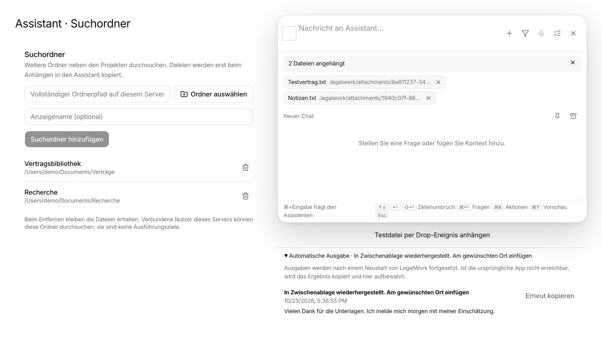

# Search folders, file drops and automatic output recovery

Follow-up to fork PR #2, based on `6bd3b532`. Implements the three requested additions to the [unified Assistant plan](proposals/global-assistant-launcher.md).

## Search folders

Settings → Assistant now manages additional named search folders. The server persists canonical paths and deduplicates aliases. Configuration requires owner access; connected viewers can search/read these explicitly shared roots. Removing a source leaves its files intact.

The `f` search includes recursive filename/path matches and the existing bounded document-content search, with source labels, coverage, file type/date filters, previews and explicit attachment actions. Project-scoped searches stay inside the selected project. The active query refreshes while a new index is being prepared, with a bounded polling window that stops when hidden. Additional roots are not projects or execution targets. Attaching a result copies that file into the Assistant's private attachment directory; Raycast uses the same route. Paths outside a registered root, escaping symlinks, replaced roots and removed sources are rejected.

Limits: 32 roots, existing index/content preparation limits, no hidden directories or dependency/build folders in the index. A folder path refers to the connected server; the local desktop offers its native directory picker. Remote/connector federation is separate work.

## File drops

The launcher accepts multiple files by drop, paste or file chooser, with an upload status. Uploads preserve successful files when another file fails. Draft ownership stays protected until each uploaded reference is saved; switching chats cannot redirect a pending upload into another conversation. Search-result attachment actions receive the same conversation protection.

Limits: 50 context items per message and 64 MiB per uploaded file. Directory drops explain how to add a search folder. Uploaded attachments are copies, not live folder references. An interrupted upload itself is not resumed after an application restart.

## Automatic output

Quick actions with Copy or Insert record their output intent in the desktop process before dispatch. The journal is written atomically with private file permissions. It binds the original request, user message, conversation, output policy and opaque origin ID. It contains no server credentials. A hidden/reloaded renderer and a conversation switch do not control delivery; startup resumes pending outputs using the desktop runtime's current connection.

A read-only server endpoint pages engine history and selects the completed answer for that exact user message. Partial, failed, interrupted and unrelated replies are not delivered. Delivery is serialized and acknowledged persistently. Offline servers retain waiting items. A request that never arrives expires after 24 hours with a visible failure.

Native insertion still validates the original app/window. After a full desktop restart the old origin is unavailable, so the result is copied instead. A crash between an external paste and acknowledgement cannot be made exactly-once: an uncertain paste is **never repeated** and its saved text is recovered to the clipboard. The output history shows pending/completed/failed results, allows cancellation before delivery and provides manual copy. Cancelling output does not cancel the model's work. Completed outputs are not replayed.

Durable automatic output is for the desktop's local Assistant. The browser keeps its existing foreground behavior; a desktop connected to a different server receives an explicit error before an automatic-output quick action is dispatched. No model execution is automatically restarted when a stopped engine has interrupted its reply.

## Validation and reproduction

Final results: **72 focused tests pass** (28 app, 20 server, 24 desktop). App/server/desktop typechecks, all 138 desktop bridge methods, EN/DE translation checks, app/server production builds and Raycast typecheck/build pass. Vite still reports existing chunk-size/mixed-import warnings.

Run from the repository root unless a directory is specified:

```sh
pnpm --filter @legalwork/app typecheck
pnpm --filter legalwork-server typecheck
pnpm --filter @legalwork/desktop typecheck:electron
pnpm --filter @legalwork/desktop check:electron
pnpm --filter @legalwork/app test:i18n
pnpm --filter @legalwork/app build
pnpm --filter legalwork-server build
pnpm --dir apps/raycast-legalwork typecheck
pnpm --dir apps/raycast-legalwork build
```

Focused tests:

```sh
# apps/app
bun test tests/launcher-*.test.ts tests/home-submission.test.ts
# apps/server
bun test src/launcher-*.test.ts src/assistant-output.test.ts src/assistant-conversation*.test.ts src/assistant-submissions.test.ts src/main-assistant.routes.test.ts
# apps/desktop
node --test electron/launcher/*.test.mjs
```

New regression coverage exercises root persistence/boundaries/removal, explicit attachment copies, partial upload failures, draft handoff and context limits, recording output before dispatch, uncertain retry identity, history pagination, queue restart, duplicate polling, cancellation, offline recovery and clipboard/journal failures.

UI smoke: the real settings, launcher and output-history components were mounted with in-memory service fixtures. Adding a folder and a synthetic two-file browser drop were exercised; the uploaded file appeared as removable context and recovered output could be inspected. This caught and corrected the add-folder button's missing submit type. The screenshot below is fixture data, not a full native end-to-end run.



Native acceptance still needs a running desktop/engine and OS permissions. No signed desktop package, actual Finder/Explorer drag gesture, live Raycast run or real external-app paste was exercised here. Reproduce with `pnpm --filter @legalwork/desktop dev:electron`:

1. Add two disposable search folders in Settings → Assistant, place a uniquely named text file in a subfolder, search with `f`, preview and attach it. Remove the source and verify the original file remains.
2. Drop two files into the launcher, switch conversations while uploading, return to the original chat and inspect its attachments. Repeat with paste and file chooser; test one failed upload and a directory drop.
3. Configure Copy and Insert quick actions. Submit, hide/reload the panel, and inspect automatic output and its history. Submit two actions in different chats and verify both results remain available.
4. Quit/relaunch LegalWork while an output is pending. If the engine finishes the reply, it must be recovered to the clipboard, never pasted into whichever app happens to be frontmost. Interrupted replies must not produce partial output.
5. Change the originating app/window before delivery; verify clipboard fallback. Cancel a waiting output, then allow its reply to complete and verify no automatic delivery.

The full application suite and native packaging were not run for this follow-up. No DCO changes or sign-offs are included.
