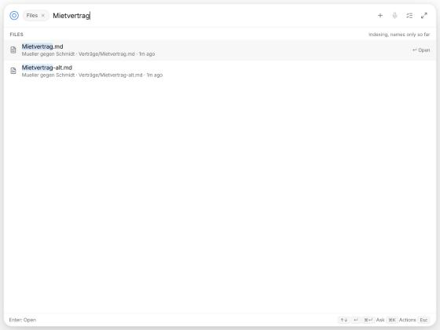
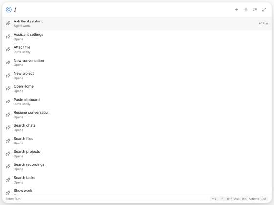
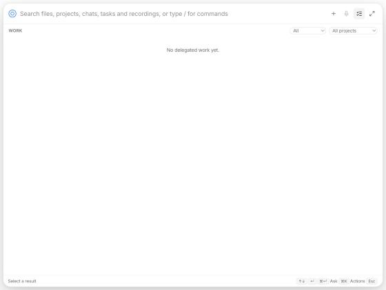
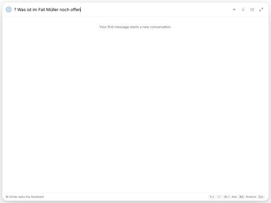
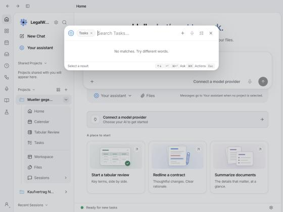
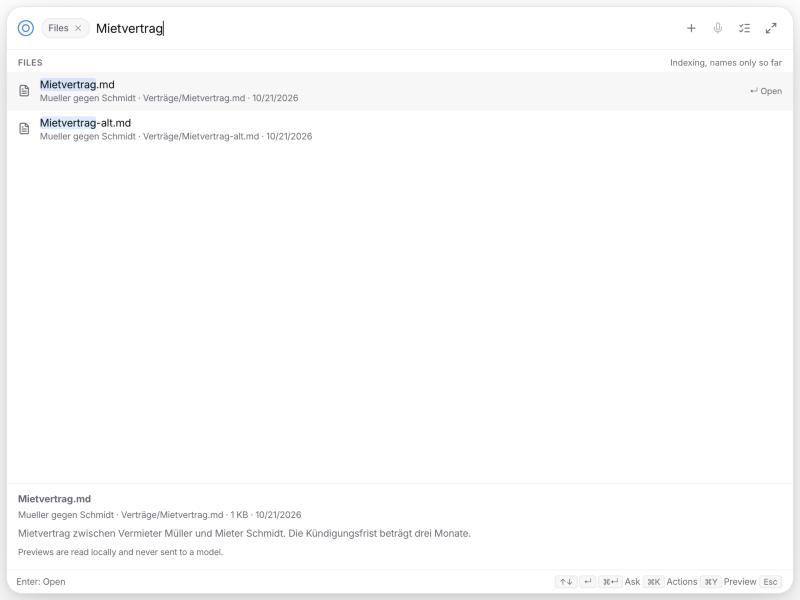
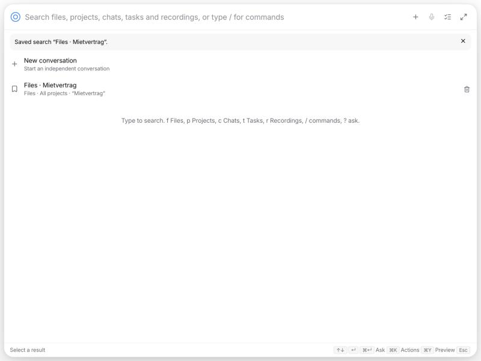
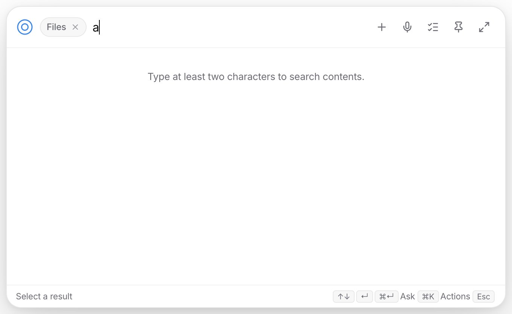
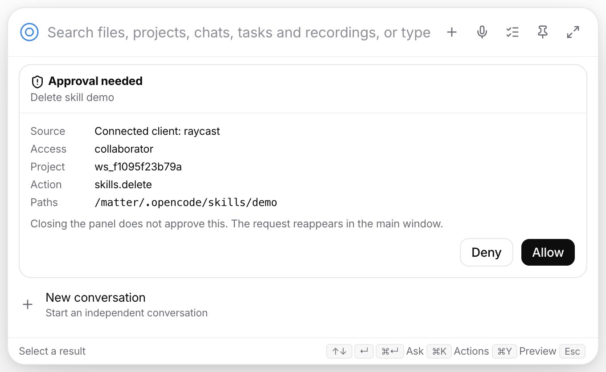

# Global Assistant: implementation notes

This documents the implementation of the complete experience specified in [`docs/proposals/global-assistant-launcher.md`](proposals/global-assistant-launcher.md). It records what exists, how the contracts from the proposal are enforced, what was verified, and what remains open.

## Surfaces and entry points

| Entry | Where | Behaviour |
| --- | --- | --- |
| Global shortcut (default `Cmd/Ctrl+Shift+Space`) | `apps/desktop/electron/launcher/launcher-service.mjs` | Captures the external origin, shows the quick panel on the keyboard-focused display, delivers an `open` invocation. Visible and focused: toggles the panel away. |
| Direct shortcuts | Settings, Assistant launcher | Files, ask, speak, region capture, add selection, and any saved quick action. The selection shortcut reads the selection as part of the invocation, before the panel takes focus. |
| Floating companion | `apps/desktop/electron/audio/dictation-hud.mjs` | The existing non-focusable HUD gains an Assistant handle with the attention count and recording state. It never takes typing focus. |
| In-app `Cmd/Ctrl+K` | `apps/app/src/react-app/launcher/launcher-dialog.tsx` | The same panel component inside the main window, replacing the previous shell-scoped palette. |
| Home | `apps/app/src/react-app/shell/session-route.tsx` | Binds to a concrete conversation; the composer claims the shared draft lease on focus. |
| Tray | `apps/desktop/electron/tray.mjs` | Open Assistant, Search files, New question, Work needing attention. |
| Deep links | `legalwork://assistant/<action>?invocation=…&q=…&context=…` | Routed to the panel by the desktop process, including cold start; repeated delivery of the same invocation ID is ignored. |
| Raycast | `apps/raycast-legalwork` | Five commands over a launch URL plus the paired loopback connection. |

The panel is a dedicated route (`#/launcher`) of the normal renderer bundle: it shares the connection, theme, i18n and the chat components, and mounts no workspace shell.

## Keyboard model

Implemented in `apps/app/src/react-app/launcher/launcher-query.ts` and `launcher-keyboard.ts`, tested in `apps/app/tests/launcher-query.test.ts` and `launcher-keyboard.test.ts`.

- `f`, `p`, `c`, `t`, `r` plus Space or Tab at the start of the query become a removable category chip. Bare letters, pasted prose and chat text stay text. Aliases are configurable; collisions are reported in settings.
- `/` opens commands and skills, `?` plus a space enters a conversation. A question-shaped search stays a search.
- Backspace at the start removes the category chip and keeps the query. The project scope chip is separate and never removed with a category.
- Up/Down keep the selected row by stable ID while results stream in; a vanished row requires a new selection. Enter runs the selected row's visible action, which the footer names. No selection means no model request.
- `Cmd/Ctrl+Enter` asks the Assistant with the typed text and staged context. `Cmd/Ctrl+K` opens the action menu. Escape closes the innermost menu or preview, then clears the filter, then dismisses an unpinned panel. IME composition never submits.

## Search

`GET /launcher/search` (`apps/server/src/launcher-search.ts`) fans out to projects, files, chats, tasks and recordings. Every source reports its own coverage (`complete`, `partial`, `filename-only`, `indexing`, `searching`, `unavailable`), so a slow or failed provider never reads as "nothing found". The incremental filename index (`launcher-file-index.ts`) walks a project once, keeps it current through the platform watcher, and ranks exact, prefix, word, substring and fuzzy matches; a keystroke never rewalks a folder. Content matches arrive in a second pass that appends without reordering what is on screen (`launcher-search-session.ts`).

Result actions are only advertised when the provider can execute them: open, reveal, open with default app, attach, ask, compare, summarize, copy path, pin, mark done, hand to Assistant, play, resume. Multi-select with `Cmd/Ctrl`+click or the row checkbox enables compare and summarize over exactly the selected files.

## Previews and saved searches

- `Cmd/Ctrl+Y` or the Preview entry of the actions menu opens a pane under the results for the selected row: a text file or the prepared text of a document, the last turns of a chat, a task with its status and due date, or the transcript of a recording. The pane follows the selection, shows when only the beginning is visible, and `GET /launcher/preview` reads locally; nothing in a preview reaches a model.
- `Cmd/Ctrl+S` or Save this search stores the current category, project and words on the server (`/launcher/searches`). Saved searches appear on the idle view and in the `/` command menu with their scope spelled out, apply exactly that scope when chosen, and can be deleted from the idle row.

## Conversations, drafts and submissions

- `apps/server/src/assistant-conversations.ts`: explicit conversations in the Assistant workspace with pin, archive and search. Daily sessions from the first Assistant version stay readable as `day:YYYY-MM-DD`. `GET /assistant/conversations/current` is read-only; nothing creates a conversation except `POST /assistant/conversations`, a first Home message, or opening the Assistant from the sidebar.
- `apps/server/src/assistant-submissions.ts`: every submission carries a client request ID and message ID before dispatch. A retry after a lost acknowledgement resends only when the engine has no record of the message; status is reconciled from the engine (`sending`, `accepted`, `running`, `completed`, `failed`, `unconfirmed`).
- `apps/app/src/react-app/launcher/draft-coordinator.ts`: one authoritative, revisioned draft per conversation (text, attachments, pasted material, scope, pending transcription, model preferences, submission state). Exactly one editor holds the lease; focusing a composer or expanding to Home transfers it with the whole draft. Broadcasts notify, the persisted file decides, and a crashed renderer never overwrites a newer revision. On the desktop the file lives in the app data folder, not `localStorage`.
- Delegated results return to the conversation that started them (`destination` in `apps/server/src/server.ts`); only an archived or deleted origin falls back to the current conversation. No midnight retargeting.

## Work and attention

Host approvals (manual HTTP approvals the local server asks the desktop for) are system UI in the panel: while the panel is visible they arrive as a card with Deny focused, the answer goes back over `launcherApprovalReply`, and hiding the panel hands the request to the native dialog on the main window unanswered. Closing the panel never approves anything.

`GET /assistant/work` lists every delegated job with its origin conversation, exact destination, live status and pending attention; `POST /assistant/work/:workspaceId/:sessionId/{stop,reply,redirect}` affects that job only. Pending questions and approvals are read from the engine (`GET /assistant/conversations/:id/attention` plus the existing delegated attention routes), so a blocking question is visible even when the model never presents it.

## Scope and execution target

Search scope (chip), source (provenance on each staged item) and execution target (the "Work in …" chip) are three different things in the panel. The target is frozen into the submission's context envelope and enforced on the server: a request bound to a project cannot be delegated elsewhere (`delegation_target_constraint` in `routes/main-assistant.ts`), and the Assistant's project-creation tool is refused for such a request. Captured text is quoted to the model as reference material.

## Context, capture and voice

Capture ownership is pushed to the panel as it changes (`voice` events from the dictation and meeting state machines), so the Speak button and its explanation never wait for the 15-second status poll. The panel reports its own capture and the pending attention count back to the desktop, which the companion shows.

- Add selection, paste clipboard, attach file, capture window and capture region are explicit actions (`context-capture.ts`). Captures are saved into the Assistant project and previewed with source app, window and time.
- The desktop origin service (`origin-service.mjs`) records the frontmost app before the panel takes focus; the native macOS helper gained `--frontmost`, `--selected-text` and `--activate` modes (Accessibility, no continuous monitoring). Windows uses `GetForegroundWindow`, UI Automation text patterns and `SetForegroundWindow`. Insert validates the destination (process and window title) after reactivating it; a changed destination copies the result and says so.
- Voice has three destinations. The panel's Speak button uses the existing composer dictation pipeline; the desktop reports external dictation and meeting state in `launcherStatus`, and the panel refuses to start a second capture while either is active (`voice-coordinator.ts`).

## Desktop lifecycle

- `launcher.json`: shortcut, background presence (independent of dictation), autostart, companion, aliases, direct shortcuts, pinning, position memory.
- One shortcut registry (`launcher-shortcuts.mjs`) reports duplicates, collisions with the dictation chord and registrations the OS refused; wake re-applies only lost chords.
- Host approvals are presented in the quick panel while it is visible, otherwise in the main window.
- The panel hides on blur unless pinned or a capture/dialog of its own is open; it repairs off-screen remembered positions.

## Raycast

`apps/raycast-legalwork` reads `launcher-pairing.json` (written by Settings, Assistant launcher, with mode 0600 and a per-session token). Launch URLs carry identifiers only; selected text is staged over the loopback connection as a one-time context that expires after five minutes.

## Screenshots (smoke runs, no engine attached)

Taken against the panel route served by Vite with an isolated LegalWork server over two sample matters. These show the rendered surfaces; the Electron window, shortcuts and capture need the desktop run listed below.

| | |
| --- | --- |
| `f Mietvertrag`: the Files chip, project and path per result, coverage "Indexing, names only so far", footer "Enter: Open" |  |
| `/`: app actions with their execution kind (opens, runs locally, agent work) |  |
| Work view with status and project filters |  |
| `? …`: explicit ask mode; the first message starts a new conversation |  |
| The same panel embedded in Home on `Cmd/Ctrl+K`, with `t` activating the Tasks category |  |
| `Cmd/Ctrl+Y` on a file result: the preview pane under the list shows the file's text, its size and date, and that nothing was sent to a model |  |
| After `Cmd/Ctrl+S`: the saved search on the idle view with its scope ("Files · All projects · “Mietvertrag”") and its delete control |  |
| The panel as its own Electron window on macOS (dev build, isolated profile without projects): the `f` chip and the two-character hint |  |
| A host approval as a card in the Electron panel (dev build): source, access, project, action and paths, Deny focused, with the note that closing the panel hands the request back |  |

## Review round

Two independent review agents read the implementation diff (one for correctness and security, one for plan compliance). What they found and what changed:

- The execution constraint now binds only while the identified request is in flight (`activeConstraint`: the oldest unfinished submission of the session); a finished panel request no longer refuses later Home messages, and a queued general question does not unbind a running job.
- A new query renders the server's order; only the content pass for the same words keeps rows in place. Hiding the panel clears a typed search or command; a conversation draft stays.
- Sends read the live store, so a target chosen a moment before ships with the request. Context staged by an invocation survives the draft claim.
- Draft handoff is two-way: reopening or focusing the panel adopts the draft another surface edited; Home shows the panel's draft on mount but takes the lease only on focus; Home's write-back strips the rendered context so nothing is sent twice.
- `Cmd/Ctrl+K` inside the Home-embedded panel opens the result's actions, and that panel binds the conversation open in Home.
- The file chooser and an active dictation hold the panel open; cold-start invocations wait for the renderer's first drain; a watcher event during an index rebuild schedules another walk; a provider that exceeds its budget reports partial, not unavailable; Work filters before limiting and an idle job without a result reads as returned.
- Remote projects appear as unavailable sources instead of nothing; Assistant conversations are searchable under `c` and resume in place; conversations can be pinned and archived from the panel.
- Replies have Copy and Insert into the origin app; a quick action's copy or insert output policy applies to the reply that answers it; project-scoped slash commands bind their project; a quick action that needs a project says so.
- Dictate and Record are real destinations: `legalwork://assistant/dictate` starts system dictation into the front app without opening the panel, Record opens the meeting recorder; the desktop reports recordings started by another window as a live microphone owner.
- Quick-action shortcuts are registered with the desktop registry when saved; the panel stays warm under background presence; the dictation's global Escape is suspended while the panel has focus.
- The Raycast pairing file never carries the owner token and is rewritten when the server comes up; Raycast opens files by path and attaches a staged file reference for Ask; quick actions stage only the inputs they declare.
- Pasted prose that starts with an alias stays text; the preview route resolves symlinks before the project boundary check; desktop events are validated with zod before the renderer acts on them; the listed `as` casts were removed.

Still open after the review: a multiline composer honouring the Enter/Shift+Enter preference, file type and date filters plus copy/move to project, the Windows selection action advertised while it cannot work, and measured performance numbers.

## Verification

Automated:

- `pnpm --filter legalwork-server typecheck`, server unit tests for conversations, submissions, file index, search, actions, staged context, work and delegation destination.
- `pnpm --filter @legalwork/app typecheck`, `pnpm --filter @legalwork/app test:i18n`, app unit tests for alias parsing, keyboard stability, draft handoff and crash reconciliation, voice ownership, deep links, search session cancellation and merging, conversation resolution.
- `pnpm --filter @legalwork/desktop typecheck:electron`, `check:electron`, desktop unit tests for settings, shortcuts, origin validation and insertion, pairing, placement and the service's invocation path.

Electron runtime check on macOS (dev build, isolated profile, no engine), driven over the renderer's IPC bridge: the app boots with the launcher service (`launcherStatus` reports the global shortcut as registered without conflicts and the native helper capabilities for selection, insertion, capture and origin); `launcherWindowControl("show")` opens the panel window on the launcher route, which loads the catalog and the conversation list; `f ab` queries `/launcher/search` and renders the Files chip with its coverage; Escape first clears the query and then hides the window; enabling the companion creates the dictation HUD window with the Assistant handle; Raycast pairing writes `launcher-pairing.json` with mode 0600 and removes it on disable.

Second round, web smoke run over the same sample matters: `Cmd+Y` on `f Mietvertrag` shows the file preview, `Down` moves the preview to the next file, `Cmd+S` saves the search, the saved search appears on the idle view and in the `/` menu with its scope, choosing it restores the chip and the words, and the delete control removes it. Electron dev build: a synthetic approval event renders the card with Deny focused and Deny clears it; a synthetic voice event disables and re-enables the Speak button.

Manual and platform tests that still need a real device run are listed in the pull request: macOS Spaces/fullscreen, Windows foreground-lock and mixed DPI, sleep/wake, Raycast cold start and the end-to-end recording.
