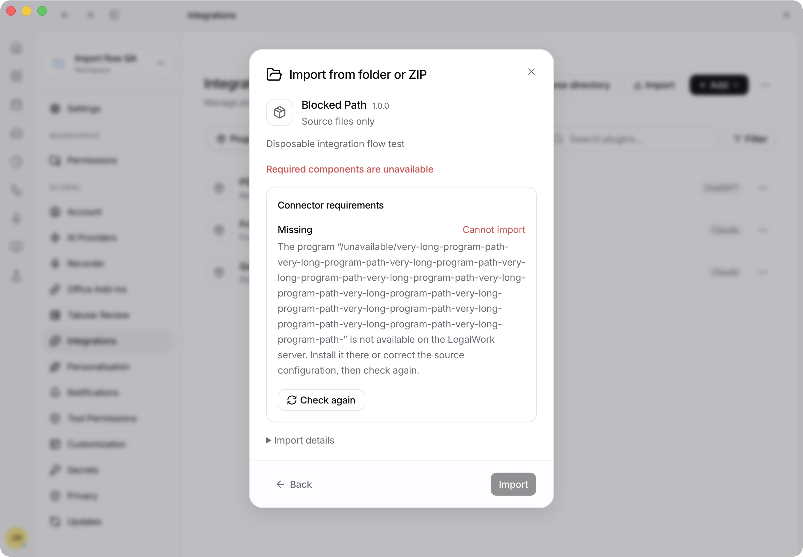
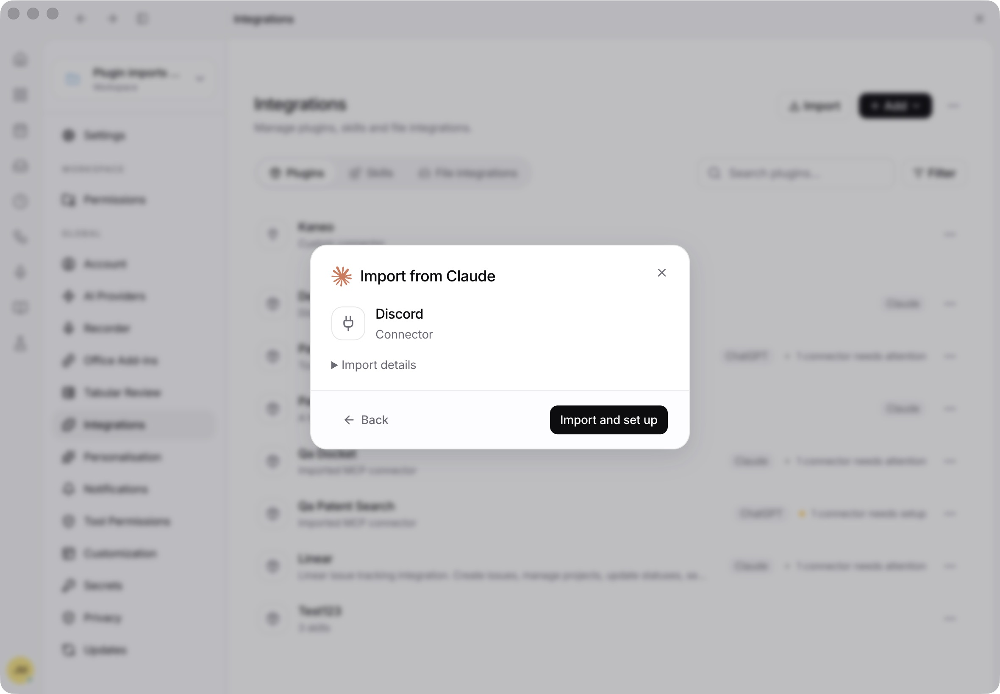
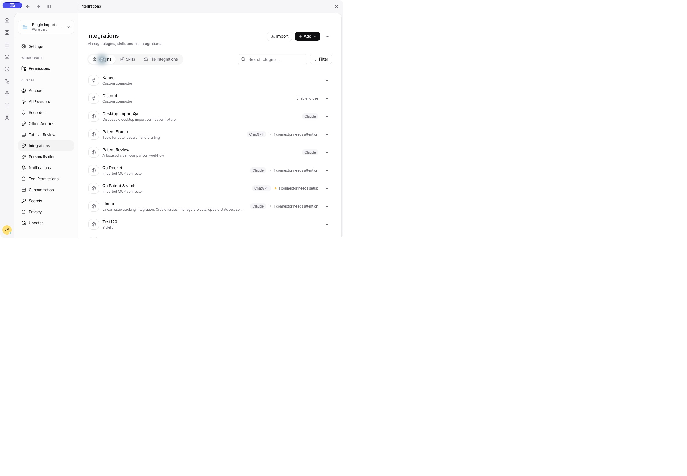

# Integrations import flow QA — 19 October 2026

This pass used the actual Electron UI in a disposable profile, workspace, runtime database and global library. Existing user installations were not changed. Source packages were read as data; their instructions were not executed.

## Findings fixed

| Finding | Result |
| --- | --- |
| Large plugins bypassed discovery assessment when Markdown consumed the 64-file JSON metadata budget. Figma remained offered despite a blocked review. | Separate bounded document and configuration budgets; invalid assessment no longer advertises an installable plugin. Regression covers 80 supporting documents, a required hosted app and a malformed package. |
| Standalone source connectors skipped compatibility assessment, including source-app sessions, unsupported permission rules and unavailable programs. | Reuse the static assessment and program availability check. Credential setup remains discoverable. Checks never execute programs or contact providers during discovery. |
| Global folder/ZIP and GitHub entries opened the legacy skills-only importer. | Use the package review flow. Generic sources detect Claude/ChatGPT manifests per package, including mixed archives; provider identity remains correct. Read-only skill-only clients retain their existing permission path. |
| A cold start could cache an empty Plugins library before the server connected. | Wait for the server and reload the library when the connection becomes available or changes. A second full Electron restart restored all three test imports without a manual refresh. |
| A long program path overflowed the connector requirements panel. | Wrap unbroken paths throughout review content; allow connector status headings to wrap. Visually verified with a long unavailable command. |
| Local cache details repeated the version as both the folder name and version. | Show the package name when its source folder is its version. Actual PDF now shows `PDF · 26.1015.12040`. |
| Source status said only “Installed”, which could be confused with installed in LegalWork. | Use “Installed in source” / “Disabled in source”, with corresponding German translations. |
| Uploaded archives offered a source-update check that always errored. | Show how to reimport the newer archive using the same filename; retain source update checks for real folders, repository URLs and filesystem archives. |
| Imported skill instructions exposed generated package paths and component mappings. | Collapse that generated footer under Technical details in the shared skill dialog; retain the complete source in Edit. Verified the normal instruction stays visible and the editor preserves the full text. |
| The user-facing history label still said “Importverlauf”. | Use “Versionsverlauf” / “Version history”. |

One source scan exceeded the old ten-second client limit. The same endpoint then returned 11 candidates in 234 ms; direct Node and Bun scans returned in approximately 130 ms. Discovery now has its own thirty-second allowance. The initial cold-scan delay was not reproduced or conclusively attributed to a single filesystem operation.

## Actual UI checks

- Import provider chooser and its category/search controls; no global/project picker.
- Actual OpenAI PDF import: review, install, immediate list publication, skill details, return navigation and unchanged-source update check.
- Actual Claude Frontend Design import: review, install and immediate list publication.
- Native folder selection of the real OpenAI PDF source reaches a ready review and recognizes the existing copy.
- Generic ZIP import of a disposable plugin containing one skill and an anonymous HTTP connector.
- Open its connector from plugin contents, enable it against a local MCP test endpoint, return to the parent and see the setup warning disappear.
- Create a separate plugin from an imported skill; validate disabled empty submission, selection count, successful creation, confirmation and immediate removal.
- Skills tab opens the same skill detail UI; generated metadata is collapsed and the full source remains editable. File storage retains the shared toolbar/search layout and firm-managed entries offer View details only. No firm storage connection was changed.
- Search with no matches and clear search to recover the list.
- Browse directory from Plugins opens the existing Connector directory and returns to the library.
- Blocked archive review disables Import and explains the unavailable program without horizontal overflow.
- Cold restart restores the populated plugin library automatically.
- Final real ChatGPT discovery returns successfully and excludes Figma and the unavailable Computer Use connector.

## Automated verification

- `OPENCODE_TEST_BINARY="$PWD/apps/desktop/resources/sidecars/opencode-aarch64-apple-darwin" pnpm --filter legalwork-server exec bun test src/plugin-imports.test.ts src/plugin-import-checks.test.ts src/plugin-import-runtime.test.ts src/connector-imports.test.ts src/bundled-connector-imports.test.ts src/plugin-import-lifecycle.test.ts src/plugin-import-source.test.ts src/claude-plugin-bundle.e2e.test.ts src/mcp.oauth-flow.e2e.test.ts` — **94 passed**. Real engine OAuth tests use a controlled provider.
- `pnpm --filter @legalwork/app exec bun test tests/plugin-import-readiness.test.ts tests/plugin-import-buttons.test.tsx tests/integration-libraries.test.tsx tests/plugin-import-presentation.test.ts` — **33 passed**.
- App and server type checks — passed.
- App and server production builds — passed. The app build retains the existing large-chunk warning.
- `pnpm --filter @legalwork/app test:i18n` — **6,795 keys in both shipped languages**, passed.

## Limits

Real provider OAuth consent, account permissions, IP allowlisting and paid seats were not granted or validated. No external account credentials were copied. The anonymous local connector verifies UI activation and state propagation, not authenticated GitHub/Figma/Context7 access. No arbitrary imported skill was executed. Fresh remote GitHub downloads were not repeated in this pass; remote parsing/error cases remain covered by automated tests and the earlier [real-package audit](plugin-import-real-package-audit.md).

## Compact review follow-up

The normal connector review now shows the item name, type and one “Import and set up” action. Routine availability/dependency checks, version and source metadata live under Import details. Blocking checks and omitted features remain visible before import; unreviewed sources retain their required check action. Repeated setup summaries, connector names and status badges have been removed.

Verified the actual Claude Discord review in the regular Electron preview, including expanding and collapsing its technical details. No import, program execution or provider authorization was performed in this follow-up. The focused app suite passes **60 tests across seven files**, including new regressions for setup, blockers, partial imports and unreviewed sources. App type checks, production build, **6,824 translation keys in both languages** and `git diff --check` pass.

## Automatic review refresh follow-up

An expired or invalidated server review now triggers a fresh preview and one automatic install retry while the existing loading state stays active. Unchanged contents use the new server token; changes to the source, components, permissions, requirements or omitted behavior return to the refreshed review and clear partial-import consent. Other failures are not retried, preventing duplicate writes after an ambiguous timeout. Repeated review invalidation is bounded and leaves the refreshed review visible.

- Regression first reproduced: the new refresh suite had **one passing and five failing tests** with the original install behavior. All six now pass; the combined import/integration suite passes **66 tests across eight files**.
- Command: `pnpm --filter @legalwork/app exec bun test tests/plugin-import-refresh.test.ts tests/plugin-import-checks.test.tsx tests/plugin-import-readiness.test.ts tests/plugin-import-presentation.test.ts tests/plugin-import-buttons.test.tsx tests/integration-libraries.test.tsx tests/mcp-library.test.tsx tests/plugin-create-connector.test.tsx`.
- Actual HTTP API reproduction for **both Claude and ChatGPT** in a disposable global library: advance the server clock sixteen minutes after preview, then invoke the same recovery function used by the dialog. The first install returns `connector_review_expired`; a new preview and second install succeed. Each installed record has exactly one history entry and one connector. No program is executed or provider contacted.
- App type checks, production build, **6,825 translation keys in both languages** and `git diff --check` pass. The visible review design remains the compact screen above.

## Combined library spacing follow-up

The combined Plugins page retained a 24-pixel section gap between standalone connectors and plugin bundles, while rows inside each group used four pixels. Both renderers now share a four-pixel content wrapper. Verified the actual Kaneo → Discord → Desktop Import Qa rows in Electron and switched to Skills and back to confirm tab isolation. `pnpm --filter @legalwork/app exec bun test tests/plugin-import-buttons.test.tsx tests/integration-libraries.test.tsx tests/mcp-library.test.tsx` passes **40 tests**; app type checks and `git diff --check` pass. Updated the existing legacy-route assertion to allow styled containers while still requiring visible connectors.

