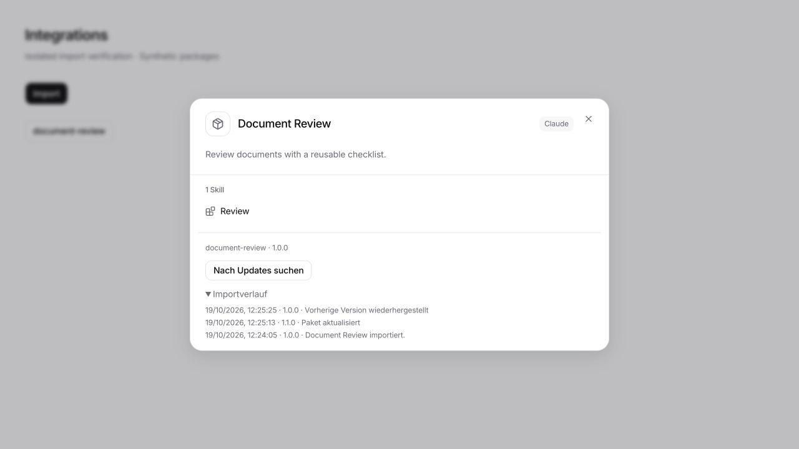

# Tracked imports and whole-package readiness

Built on `dev` at `e3900fa4` (19 October 2026). This extends the existing connector compatibility checks; it does not replace the runtime or transfer another application's accounts.

## One foreign import path

Integrations uses the global library. The import dialog has no project/global switch, and application preview/install requests enforce global scope on desktop and web. Standalone GitHub/folder/archive skills and browser skill creation/editing follow the same rule. Skill reads include the global library for remote workspaces as well. Existing on-disk project data is not moved or deleted by this UI change.

Discovered ChatGPT/Claude installations, folders, ZIP/`.plugin` archives, GitHub plugins, and standalone GitHub/local skills use the server package planner and installer. The old GitHub plugin resolver is removed. Immutable archive downloads share a bounded, five-minute cache so selecting multiple folders does not repeatedly download the same repository. GitHub skill scanning remains a discovery adapter; selected folders install from immutable commit archives, preserving supporting files on desktop and remote workspaces. Native LegalWork firm-library payloads remain a separate native format.

1. Load bounded, ordinary files without executing package code. Resolve GitHub refs to a commit and download the complete snapshot. Keep existing traversal, link, archive size and credential boundaries.
2. Build one plan containing source identity, provenance, components, declared requirements and connector feasibility checks.
3. Prepare server-owned review, bound to package identity/digest, workspace, scope, installed dependencies and owned connector setup. Revalidate after approval under the import lock.
4. Reject missing required dependencies, nonportable registered app references and execution/permission semantics LegalWork cannot preserve. Independent omissions require explicit consent. Excluded connectors retain their reasons in plugin details.
5. Install complete files, refresh the library, and retain source/version/revision, history and rollback snapshots.

Source identity includes provider, source location, selected repository directory, package root, standalone connector selection and installation scope. Identical names from separate publishers cannot share a review token or overwrite each other. Source edits at the same location update the same installed copy. Selecting a different local source location creates a separate copy; versioned third-party cache folders are not assumed to be the same publisher.

## Discovery and readiness

Discovery distinguishes installed, disabled, account-synced and available cache entries. It excludes trash/backup folders and resolves linked installation roots to their canonical source. Package-internal links remain rejected. These labels describe the source installation; they do not reuse its account session.

A compatible installed dependency must match the declared name, version range and marketplace when supplied. Ambiguous matches and missing/incompatible requirements block installation. Requirements remain recorded when satisfied. Dependencies are not silently downloaded or executed. Registered ChatGPT app IDs do not include transferable connector definitions or credentials; actual app references block the package, while an empty `.app.json` does not.

Import readiness is an import-time assessment, not live connection health. **Ready**, **Setup required**, **Partially usable**, and **Required components unavailable** distinguish usable content from prerequisites and omitted behavior. Account approval, credentials, seat restrictions and authenticated IP rules can only be established when connecting. The existing connector runtime remains authoritative for live status.

## Portable format

The loader applies local versioned [Agent Plugins 1.0.0 manifest rules](https://agent-plugins.org/schemas/1.0.0/plugin.schema.json), [connector rules](https://agent-plugins.org/schemas/1.0.0/mcp.schema.json), and the [client checklist](https://agent-plugins.org/client-implementers/conformance). It never fetches a schema selected by a package. Unsupported schema versions fail before installation. Invalid connector documents/entries are isolated, with useful reasons; valid independent skills survive as an explicitly partial import.

Portable skills use immediate children of `skills/`. Program arguments, environment values and working directories expand `PLUGIN_ROOT` and `PLUGIN_DATA`; working directories stay within those boundaries. `PLUGIN_DATA` lives separately from replaceable package files and survives updates/restore. Claude's plugin data placeholder maps to the same owned location. Portable stdio and Streamable HTTP are supported. Portable SSE-first transport is blocked because the current engine cannot preserve that initial transport contract. Legacy Claude SSE compatibility remains unchanged. Unsupported hooks, background behavior and permission/execution restrictions are never claimed to run.

## Updates and restore

Plugin details offer **Check for updates**, a review of the replacement, import history and **Restore previous version**. GitHub checks resolve the tracked ref again; pinned commits remain pinned. Local source paths can be checked again. Uploaded archives and standalone configuration selections must be chosen again through Import. Older packages without provenance explain that a tracked reimport is needed.

Updates replace complete owned directories and remove obsolete resources. File hashes detect edits and linked files before update/restore; LegalWork refuses to overwrite local changes. A failed install restores previous files, owned connector configuration and registry state. Up to three previous snapshots and fifty history entries are retained. Snapshots containing connector configuration are private local files. Persistent plugin data is outside the replaced directories. Restore stages recovery copies before mutating installed files and also restores owned connector configuration. Source updates continue to use existing connector setup merging and endpoint-change protection.

## Operator-owned OAuth metadata

Set `LEGALWORK_MCP_CLIENT_METADATA_URL` to an operator-owned public HTTPS client metadata URL to use CIMD with providers advertising support. The document must identify that exact URL, declare `token_endpoint_auth_method: none`, and include the connector's exact loopback redirect URI. Redirects, mismatched callbacks and oversized/invalid documents fail review. The checked URL becomes the engine's client ID; no second registration occurs. No public LegalWork identity is deployed by this change. Without one, supported checked DCR remains available; CIMD-only providers requiring an unconfigured identity stay blocked. Foreign ChatGPT/Claude identities are never adopted.

The real bundled OpenCode 1.18.29 engine completed discovery, PKCE, callback, token exchange and authenticated connection using the owned metadata identity in a mock-provider regression. The mock's metadata fetch is controlled; this is runtime compatibility evidence, not approval by Figma or another real provider.

## Verification

- `pnpm --filter legalwork-server exec bun test src/plugin-imports.test.ts src/plugin-import-checks.test.ts src/plugin-import-runtime.test.ts src/connector-imports.test.ts src/bundled-connector-imports.test.ts src/plugin-import-lifecycle.test.ts src/plugin-import-source.test.ts src/claude-plugin-bundle.e2e.test.ts`
- `OPENCODE_TEST_BINARY=/path/to/opencode pnpm --filter legalwork-server exec bun test src/mcp.oauth-flow.e2e.test.ts`
- Both package type checks, production builds and `pnpm --filter @legalwork/app test:i18n`.

UI verification uses the real import/details components against an isolated server and synthetic packages: unavailable requirements disable import; a supported package installs; a source version change opens review; update records the new version; restore returns to the previous version and retains history. No real connector account or model request is used.

To reproduce manually, import a local Claude plugin with one skill and version `1.0.0`. Change the source version/content to `1.1.0`, open its details, check for updates and review/install. Open history, restore the previous version, and verify `1.0.0`. Editing an installed skill before another update must reject replacement. A plugin declaring a missing dependency must disable Import; a plugin with unsupported independent hooks must require explicit partial-import consent.

