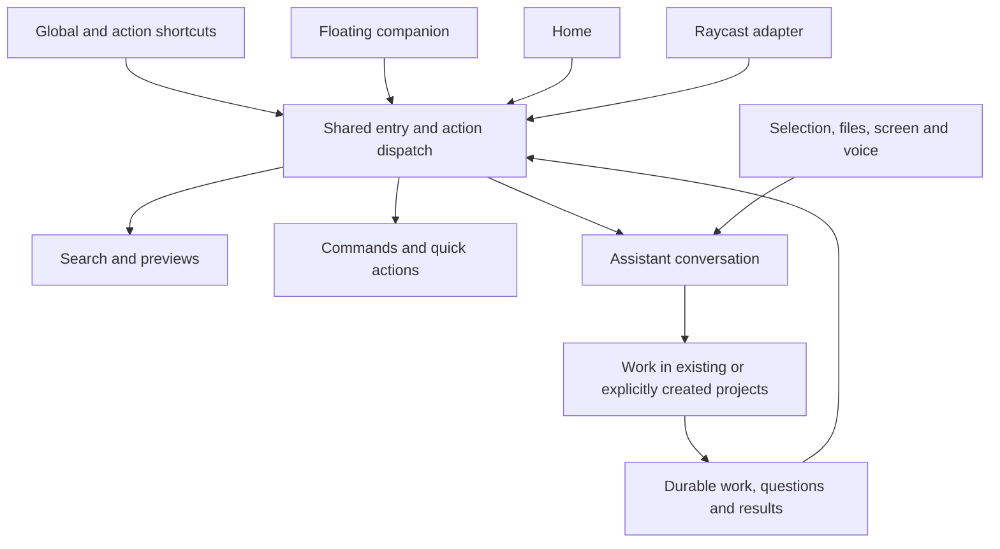

# Global Assistant: one window, one search bar, all of LegalWork

Status: full product and architecture proposal for discussion. This PR changes documentation only.

LegalWork should be available wherever the user is working: a shortcut away from finding a file, running a skill, asking a quick question, capturing context, or delegating substantial work. Search, commands, compact conversations, voice, project orchestration and Home belong to one coherent experience. The user should not have to open a project chat to begin.

The product combines the personal Assistant in [#232](https://github.com/eigenweltlabs/legalwork/pull/232), the floating dictation control from [#299](https://github.com/eigenweltlabs/legalwork/pull/299), and the existing search and command capabilities. This design specifies the complete experience, including file search, independent conversations, screen capture, voice and a Raycast adapter. Implementation is organized by dependencies, not by reducing the product to an extra chat window.

The inspected Assistant revision is `aee752e8a34c147286fb1c2d4acee4488ff5eb4d`; the inspected `dev` is `bb77ce7ce2ef0a665ad3f0704a7994b32b54672d`, which includes #299. Those branch heads were rechecked for this revision. Research was conducted on 21 October 2026. Repository features and reviewed implementation gaps are distinguished below from proposed behavior; no external application was installed or benchmarked.

## 1. Product promise

**One platform, one window, one search bar for everything the user does with LegalWork.**

From Word, a browser, the desktop or LegalWork itself, the same invocation opens a compact, fast surface. It can remain a launcher for a two-second action, grow into a short conversation, or expand into Home for longer work. A floating companion makes recording and work that needs attention visible without covering the user's document. Raycast users can enter through Raycast and reach the same work.

The Assistant remains a coordinator: quick answers stay compact; substantial tasks run in the appropriate projects. The user can keep working elsewhere, then answer a precise follow-up or collect a finished document from the panel. Dismissing the panel never cancels delegated work.

The complete experience includes:

- Universal search across accessible files, projects, chats, tasks, recordings and supported connected sources, with fast category modes.
- Commands, skills, saved quick actions, aliases, favorites and configurable shortcuts.
- Compact conversations, explicit new conversations, history, project-aware delegation and a persistent work/attention view.
- The same conversation and complete draft across the quick panel and Home.
- Selection, file, clipboard, window and screen-region attachments with visible provenance.
- Distinct voice destinations: another app, the Assistant draft, or a meeting recording.
- Explicit copy, insert, save, open and continue actions on results.
- A useful native experience on macOS and Windows, with an optional Raycast adapter.

Initial provider/account setup remains separate. Home here means the normal entry after onboarding, not the removal of setup.

## 2. One experience, three native surfaces

| Surface | Role | Behavior |
| --- | --- | --- |
| Floating companion | Always-available handle and quiet status | Optional, dockable, follows the chosen display policy; opens the panel and shows recording or actionable work. It does not take typing focus merely to display status. |
| Quick panel | Search, action, short conversation | Global shortcut, companion click or adapter invocation opens it over the current app. It grows with content, supports previews and can be pinned for reference. |
| Home | Room for sustained work | Uses the same entry, conversation and activity components with more history and workspace context. Expanding the panel resumes the exact conversation and draft. |

These are views over one Assistant and one set of actions. The native HUD and the focusable panel are separate windows with coordinated placement and theme. Visual continuity can make them feel like one control; recording correctness must not depend on an animation or on converting the non-focusable HUD into a text editor.

Default placement is centered on the active display, with an optional position near the companion. Remember user positioning within reachable bounds. A pinned panel stays visible without continually stealing focus. Opening a preview, action menu, file chooser or permission dialog must not trigger accidental dismissal. Reduced-motion settings remove decorative transitions.

The idle view should be useful: recent items, pinned actions, a resume-conversation entry and a small count of work needing attention. While typing, results dominate. In conversation, short answers and concrete result cards dominate. Tool logs stay available on demand. Pending questions and approvals remain visible regardless of how concise the model's answer is.



## 3. Keyboard model: fast when learned, visible when new

Plain text searches across enabled sources. Category aliases are shortcuts into the same visible filters, not a language users must learn. The proposed defaults are:

| Entry | Mode | Example |
| --- | --- | --- |
| Plain text | Everything | `Müller` finds relevant projects, documents, chats and tasks. |
| `f` + Space or Tab | Files | `f Mietvertrag` searches file names and indexed contents. |
| `p` + Space or Tab | Projects | `p Müller` opens or scopes work to a matter. |
| `c` + Space or Tab | Chats | `c Fristen` finds conversations and matching messages. |
| `t` + Space or Tab | Tasks | `t offen` finds tasks with status, project and due-date filters. |
| `r` + Space or Tab | Recordings | `r Mandantengespräch` finds recordings and available transcript excerpts. |
| `/` at the start | Commands and skills | `/compare`, `/summarize`, `/record`, or an existing project command. |
| `?` + Space, or the visible Ask action | Assistant | `? Was ist im Fall Müller noch offen?` enters a conversation. |
| Project scope control | Search or execution scope | An explicit project chip narrows search or binds a submitted task to that project. |

Typing `f` alone is ordinary text. An exact alias plus its delimiter at the start of the launcher query becomes a removable mode chip; it does not intercept letters elsewhere, pasted prose or text in an active chat. Backspace at the start of the query removes a category chip while keeping the query. A visible clear control and Escape offer the same action. Project scope is a separate chip and is never silently removed with a category. Aliases are configurable, and collisions are surfaced in settings.

Use the following keyboard contract in the panel, with `Cmd` on macOS and `Ctrl` on Windows:

| Input | Contract |
| --- | --- |
| Up/Down in results | Move the selected result; keep it stable by item ID as more results arrive. |
| Enter in search | Perform the selected row's visible primary action. No selection means no implicit model request or project creation. |
| Cmd/Ctrl+Enter in the query field | Explicitly ask the Assistant using the current text and staged context. A selected file is included only after an Attach/Ask-about-this action. |
| Cmd/Ctrl+K in the panel | Open the selected item's action menu. Outside the panel, keep existing app shortcuts until bindings are reconciled. |
| Tab | Activate a matching alias at the start; otherwise move through controls. Never silently change search into AI. The existing palette's category cycling must be migrated deliberately. |
| Enter / Shift+Enter in conversation | Send / newline, respecting the user's composer preference. IME composition never submits. |
| Escape | Close the innermost preview/menu first, then clear an active search filter, then dismiss the unpinned panel. Preserve conversation drafts and attachments. Never stop work or recording implicitly. |

The footer says what Enter does, including whether it opens, runs, attaches or asks. After keyboard navigation, newly arriving results cannot switch the selected identity or turn a deterministic action into an agent request. If that item disappears, require a new selection. A question-shaped search remains a search until the user chooses Ask.

Per-action global shortcuts can jump directly into Files, a new question, Speak to Assistant, capture a region, or a favorite quick action. Use one binding registry with conflict reporting; do not reuse Dictation's listen-only key monitor as if it consumed launcher shortcuts. Modifier-hold and double-tap gestures retain their explicitly configured voice behavior.

## 4. File search should feel like a core feature

`f` opens a focused file finder with names, paths, project/source labels, file type, modified time and useful content excerpts. Search filename and path matches immediately; enrich with indexed document content as providers respond. Offer filters for project, folder/source, type and modified date. Exact-name, prefix and fuzzy matches need sensible ranking, with recency and pinned items as secondary signals rather than reasons to hide a better match.

A selected file has a preview and an action menu:

- Open in LegalWork or the default application; reveal in its folder or source.
- Attach to the current Assistant draft or ask about this file in a fresh conversation.
- Select two or more files and compare, summarize or run a compatible skill.
- Copy a path/reference, pin the item, or save a reusable search.
- Copy or move into a chosen project when the source supports it, preserving existing permission and audit rules.

Previewing or selecting a result is not submission to a model. The Attach action stages a removable file reference; sending resolves a specific version or records which version was read. A result from another matter keeps its source label when attached. Moving or deleting files must be explicit result actions, never a side effect of opening or asking about them.

Scope includes accessible LegalWork projects, folders the user explicitly adds, and connected sources for which a search/read provider exists. The product does not silently index the whole disk or imply that every connected system has been searched. Show useful source states: searching, indexing, filename-only, content available, offline, unavailable or incomplete. A partial result set must not be shown as an exhaustive negative answer.

Implement search as a shared provider service rather than a second set of UI closures. Providers return stable IDs, source/workspace identity, item revision, match information, coverage and available actions. Cancel obsolete queries, bound concurrency and merge incremental results without selection jumps. Local names/paths and extracted content need incremental indexes with change/deletion handling; do not perform a full recursive folder walk on every keystroke. Reuse existing extraction and search endpoints where possible. Remote providers search remotely under the caller's access; permission changes invalidate cached previews and results.

The same result/action vocabulary applies to projects, chats, tasks and recordings. A task can be opened, completed or handed to the Assistant; a recording can be played, opened at an excerpt or attached for analysis. Only advertise actions the provider can actually execute. Saved searches and pinned results retain their scope visibly.

## 5. Commands, skills and personal quick actions

The command menu combines existing slash commands and skills with app actions such as open project, new conversation, capture screen region, start recording and show unfinished work. Each entry exposes its required inputs, target and result behavior. Project-dependent commands request a project if none is bound; they do not borrow an arbitrary recent project's directory.

Distinguish three execution kinds in the shared catalog:

1. Navigation/search: open, reveal, filter, resume.
2. Native or server operation: copy, capture, record, update an explicitly selected task.
3. Agent work: summarize, compare, translate, draft or run an agent-backed slash command.

The existing slash syntax does not imply deterministic execution: some commands go through `session.command`. Labels and progress should reflect the actual operation. Deterministic operations do not incur a model round trip.

Allow users to save a useful action with a name, alias, optional shortcut, preferred skill and input/output defaults. Examples: “Explain this clause”, “Translate selection”, “Compare these files”, “Create a task from this” and “Send to Müller matter”. A saved action declares whether it needs selected text, files, clipboard input or typed arguments and whether its output is a preview, copied text, a saved document or a staged insert. Default to a visible result; explicitly configured one-shot actions may use a previously chosen output policy when the destination is still valid.

Favorites, recent actions and keyboard hints make these features discoverable. The action definition is shared by Home, panel, HUD triggers and Raycast. Reuse LegalWork's skills and connector permissions; this is not a second prompt-template store or a general Raycast-compatible extension host.

## 6. Conversations and orchestration that survive the window

### Independent conversations, stable identity

Opening the panel shows the entry surface with the most recent conversation available to resume. If a conversation draft or response was active when dismissed, restore that view. A visible New conversation action starts an independent context; asking about a search result can either attach to the current draft or start a new conversation explicitly. History is searchable, and conversations can be pinned or archived without deleting outstanding project work.

Home and panel bind to a concrete Assistant conversation ID and engine session ID. They never resolve “today” afresh merely because the user expands the window. Daily grouping remains useful for history and migration from #232; it must not define conversation identity, cause a midnight reset, or force unrelated matters into one model context.

Keep existing daily sessions readable under their existing IDs. Add the ability to create and resume independent Assistant conversations in the same server-owned Assistant workspace. Scope the app-state reminder to the selected conversation and work; keep the system prompt stable. Archiving a conversation leaves an explicit link from unfinished work back to it, and result delivery does not automatically unarchive or switch the current conversation.

### Complete drafts and reliable submission

Share the entire draft: text, attachments, file revisions, pasted text parts, mentions, command arguments, scope, pending transcription, model/mode preferences and submission state. Persist recoverable local drafts according to existing app data policy; do not put large media in `localStorage` or assume a renderer module cache is shared.

Use one authoritative desktop draft coordinator with revisioned updates and editor ownership per conversation. Both surfaces can display live conversation state; only one owns the mutable draft at a time. Focusing the composer or expanding to Home transfers that ownership and the complete draft atomically. Different conversations may be edited independently. A renderer crash releases/reconciles the lease without overwriting newer data. Broadcast notifications distribute changes; they are not the source of truth or a substitute for conflict handling.

Every submission has a stable client request/message ID before dispatch. Retry after an ambiguous response reuses that identity. Verify engine deduplication rather than assuming a `messageID` alone guarantees it; implement server reconciliation where needed. Surface states distinguish draft, sending, accepted, running, failed and delivery unconfirmed. A surface switch cannot resubmit an accepted request. Once accepted, background execution belongs to the server, not the window.

### Work is addressable, not just a chat transcript

Each delegated job records its originating conversation, exact destination project/session, submitted context, operation identity and current status. Results return to their origin and also appear in a shared Work view. Use a short card for queued/running work, a returned file, a failed operation or an exact question. Open the full project work only when the user chooses.

The Work view spans conversations and days, supports filtering by project/status, and lets the user inspect, redirect or stop one identified job. Do not infer which of two similar jobs “stop” means. Notifications and companion badges focus on completion, failure and required input; routine progress stays quiet and never steals foreground focus.

### Questions and approvals are system UI

Read pending attention directly from the server, including items not yet presented by the model. The model may explain or summarize them, but cannot be the only route by which a blocking question becomes visible. Show source project, task, exact requested decision and unavailable-source state. Handle both delegated-project questions and the Assistant's own unanswered questions, including older conversations.

Reuse exact item IDs, revisions, workspace/session scope and server-side reply locking. Answering from Home invalidates the stale panel action and vice versa. Preserve the distinction between answering a question and granting a permission; the model cannot grant approval for the user.

Native host approvals must be associated with the requesting operation and presented in an active, appropriate LegalWork window, including the panel. Queue or re-present them through the established approval mechanism when that surface closes; never silently approve, lose the request behind a hidden main window, or treat panel dismissal as acceptance. Existing deny/cancel semantics remain explicit. Any change to approval lifetime requires integration tests.

## 7. Context, screen capture and voice

### Capture what the user actually chose

Offer Add selection, Paste clipboard, Attach file, Capture window and Capture region as explicit actions with optional direct shortcuts. Captured context becomes a removable preview with source app/window, capture time and project/source provenance where known. Screenshots can be cropped or annotated before sending. File results and drag-and-drop feed the same staging flow.

Capture the external origin before focusing LegalWork. Merely knowing the app name does not preserve its selection: the origin service must hold a usable app/window/control reference and report what can actually be retrieved. A selection-capture shortcut captures the selection as part of that explicit invocation. An ordinary launcher invocation captures origin identity only. A later Add selection action reads against that origin if supported; if focus must be returned to retrieve it, show and validate the source rather than pretending the original selection was frozen. Report unavailable context instead of reading LegalWork's own input or silently falling back to unrelated clipboard contents.

Hide the capture UI from its own screenshot where supported, otherwise use a deliberate hide/capture/restore sequence. Dismissal, permission denial or a failed capture leaves the draft intact. Nothing continuously watches or records the screen. External text/images are untrusted task material, never authority to run commands, change projects or grant permissions.

Separate three concepts throughout the flow:

- Source: where the selected text/file/image came from.
- Search scope: where results are being looked up.
- Execution target: where the requested work will run or be saved.

A source window or last-used project does not silently set the execution target. An explicitly chosen project is enforced server-side as an execution constraint. If no target is selected, the Assistant can resolve an unambiguous project from the request and make that choice visible; ask when ambiguity matters. A general question does not create a project. Project creation must follow the user's work request or an explicit create action, not instructions embedded in captured material.

Freeze a submitted context envelope with source/capture details, attachment identities/revisions and the chosen target or “Assistant general”. Changing scope later does not rewrite a running job. Do not forward an entire cross-matter Assistant history to a delegated project. Enforce tool/client scope at the server; prompt instructions alone are not an authorization boundary. Preserve existing permissions, including file-copy approval/audit. Avoid a blanket second confirmation for every already-authorized action; ask for missing target information, required permission or genuinely destructive/externally consequential actions.

### Three explicit voice destinations

| Action | Input and output | Required behavior |
| --- | --- | --- |
| Dictate into this app | Microphone to a captured external destination | Record the intended destination before the panel takes focus; revalidate before insertion. If it changed or cannot be restored, keep the transcript and offer Copy/Choose destination. |
| Speak to Assistant | Microphone to the selected conversation draft | Stream/finalize transcription into the owned draft. Stop and Send remain distinct; closing the panel preserves recording/transcript state according to the visible recording controls. |
| Record a meeting | Existing recording/transcription workflow | Show a recording destination and status, then make the result searchable and usable by the Assistant. Reuse recorder permissions and lifecycle. |

One capture coordinator owns microphone use and routes events to the right destination. Opening search cannot start a second capture or change the destination of an ongoing dictation. A mode change during capture requires an explicit transition; preserve already-recorded data. Reconcile the #232 main-renderer recorder bridge with #299 and current cloud-transcription readiness rather than cloning either pipeline into a new renderer.

The panel/HUD must communicate where speech will go. A local Escape inside a menu cannot also trigger Dictation's global cancellation; the central shortcut/recording state machine defines priority and ensures one handled event produces one action.

### Return useful output to the work

Result cards offer the actions appropriate to their content: Copy, Insert into origin, Save to project, Open document, Compare, Ask follow-up and Continue in LegalWork. Text replacement uses a preview or a deliberately configured quick-action policy. Before insertion, verify the saved app/window/control and relevant selection/version when the platform exposes them. If the exact target cannot be established, offer Copy or explicit retargeting. Never paste into whichever document happens to be foreground.

Do not steal focus later when background work finishes. Insert is a fresh user action. Undo should use the destination application's normal edit transaction when available; do not advertise reliable undo for an operation the app cannot reverse. If a platform fallback temporarily uses the clipboard, preserve and restore it only when doing so will not overwrite a newer clipboard change.

## 8. Shared architecture and native behavior

### Ownership boundaries

| Owner | Responsibilities |
| --- | --- |
| Desktop host | Global shortcuts, windows, origin/focus references, capture, microphone coordination, tray, launch URLs and app lifecycle. |
| Shared client state | Full draft coordinator, action dispatch, view state, source/provider adapters and live server projections. Native identifiers stay local. |
| LegalWork server | Assistant conversations, authenticated search/project APIs, authoritative work and attention, submission reconciliation, routing constraints and permission enforcement. |
| Engine/project sessions | Execute existing skills/tools and durable project work under the selected scope. |

Do not build a second Assistant backend, message history or command execution engine. Reuse server surfaces and extend them explicitly where capabilities are missing. Separate a read-only lookup of current conversations from creating/ensuring a conversation; focusing a window or refreshing it must not create daily sessions as a side effect.

Start the panel implementation from a dedicated route sharing the app's connection, theme, i18n, composer and attention components. Reuse the existing provider bootstrapping instead of inventing a disconnected mini-client. Keep it warm when background presence is enabled, but avoid mounting irrelevant workspace UI or a duplicate audio pipeline. Measure invocation and idle cost; extract a lighter renderer entry if those measurements justify it. A full app renderer is an implementation option, not a guarantee that cross-window ownership works automatically.

Use one desktop event/subscription broker where practical and project server events into each window. If separate subscriptions are required, deduplicate by server event/work identity and reconnect from authoritative state. Stop hidden animation/timers and obsolete searches; a hidden companion should not keep frequent foreground-display polling alive without a reason. Drafts may survive offline, while remote search and submissions clearly indicate unavailable service rather than claiming completion.

### Desktop availability and focus

The launcher has its own background-presence preference, independently of Dictation. With it enabled, closing the main window leaves the tray/menu-bar entry and shortcut active. Minimize, close/hide and explicit Quit have distinct behavior. Quit really exits and follows the existing active-recording shutdown policy. Autostart is a user setting. Launch URLs or the Raycast adapter can start a stopped app, with explicit cold-start progress.

Use a platform-specific origin/focus service. On macOS, evaluate the supported panel/key-window behavior for the installed Electron/OS combination and validate Spaces/fullscreen interaction. On Windows, capture the foreground window before activation and validate restoration under foreground-lock, privilege and corporate policy constraints. The user-facing contract is predictable return to the intended app where possible, with a recoverable state when the OS refuses; identical native flags are not required across systems.

Do not equate Dictation's current clipboard-and-paste operation with a stored target. Opening the panel during external dictation must keep the recording destination valid; until origin validation succeeds, hold the transcript instead of inserting into the panel. Losing a window, changing documents, sleep/wake or unplugging a display invalidates stale references as appropriate. Repair off-screen panel bounds. Required native integrations should expose unsupported or blocked capabilities rather than fail silently under managed Windows policies.

### Action and invocation contracts

A catalog entry contains stable identity, localized label, aliases, kind, required arguments/context, supported scopes, capabilities, execution target and available output actions. Search results refer to those operations. All entry points call the same dispatcher. Search/navigation can operate without a model, while agent actions submit through the common identified-request path.

An invocation specifies an action/mode, an optional exact conversation/work target, intended scope and references to staged context. Treat external invocations as untrusted requests and authenticate context-bearing local transport. Validate arguments, caller capabilities and accessible resources before dispatch. An invocation cannot answer a pending permission request or escalate project scope by supplying its own flags.

## 9. Raycast is a first-class optional entry point

Build the adapter alongside the shared entry contract. LegalWork remains complete without Raycast, while people who already use it get direct access to the same backend and state:

- Open/resume LegalWork Assistant or start a new question.
- Ask LegalWork with selected text, using supported platform APIs and a visible context preview.
- Search LegalWork files and projects, with direct open/attach actions.
- Run a named LegalWork quick action or show work needing attention.

Use a minimal launch URL to start/focus the app, and an authenticated local transport for context and identified submissions. A short-lived opaque context reference can cross an invocation boundary; server tokens, document contents and confidential paths must not be placed in URL query parameters. Define storage lifetime, expiry and one-time consumption for staged invocation context. A loopback endpoint must validate caller credentials/origin and cannot be an unauthenticated command runner.

The current URL-scheme registration is not a complete Assistant deep-link implementation: add the route, receiving consumer, cold-start queue and visible activation behavior. Deliver the request to the intended panel/conversation, not indiscriminately to the main window. Retry and duplicate URL delivery must not duplicate work.

Use ordinary extension capabilities and LegalWork's own model/backend access; do not require Raycast's AI product for LegalWork execution. Optional Raycast AI/MCP-specific integration can be evaluated separately. Windows is relevant too: [Raycast's Windows changelog](https://www.raycast.com/changelog/windows) records the 2.0 exit from beta on 25 August 2026. Validate individual extension APIs on each target platform rather than inferring full parity. Raycast can supply useful foreground/selection context, but does not prove LegalWork's native focus restoration or Home handoff.

## 10. Existing foundations and corrections from review

Two independent adversarial reviews inform the contracts above. Findings about source behavior are separated from architectural recommendations; neither review is treated as proof that every suggested workaround is necessary.

| Foundation | Verified baseline | Planned reuse/change |
| --- | --- | --- |
| Assistant | Server-owned workspace, daily sessions, project lookup/delegation, durable follow-ups and returns. | Keep the coordinator and project execution; add independent conversation identity and explicit origin routing. |
| Compact presentation | Short-response instructions and file/delegation/attention components. | Share these across Home/panel; direct system attention must not depend on model presentation. |
| Drafts | Renderer-local caches/state; persisted text/mode do not include the full composer. | New authoritative full-draft coordination, ownership and recovery. Sharing a session ID is insufficient. |
| Submission | Project follow-up queues already use request/message identities and reconcile uncertain sends. | Reuse those patterns and verify the initial Assistant send path separately; there is no blanket claim that the app lacks idempotency. |
| Daily routing | Main-Assistant returns can resolve the current daily session. | Stable origin conversation plus cross-conversation Work view; no silent midnight retargeting. |
| Attention/approvals | Exact IDs/revisions/scope and reply locks exist. Cards filter on presentation; host dialogs use the main window. | Render all pending system items and route host approval presentation to an appropriate visible surface. |
| Dictation HUD | Non-focusable window, focused-display tracking, docking and recording lifecycle. | Reuse placement/capture services; origin preservation/restoration for a focusable panel is new native work. |
| Search | Shell-scoped palette with local state and existing project/file search; some file searches walk directories. | Shared providers, explicit coverage, incremental indexing and reusable result actions. |
| Slash commands | Composer loads workspace commands; invocations can start agent execution. | Shared catalog with scope and execution-kind metadata; no promise that every slash action is deterministic. |
| Recorder | Assistant controls depend on the main renderer and overlap with newer Dictation/cloud readiness. | One recording owner/bridge, retaining current fixes and transcription options. |
| Deep links | Existing scheme/parser serves limited routes. | Implement Assistant routes, consumption, startup delivery and authenticated context transfer. |

Source entry points, pinned to inspected revisions:

- [Assistant role/tools](https://github.com/eigenweltlabs/legalwork/blob/aee752e8a34c147286fb1c2d4acee4488ff5eb4d/apps/server/src/opencode-plugins/legalwork-assistant-tools.ts), [daily session owner](https://github.com/eigenweltlabs/legalwork/blob/aee752e8a34c147286fb1c2d4acee4488ff5eb4d/apps/server/src/main-assistant.ts), [return destination](https://github.com/eigenweltlabs/legalwork/blob/aee752e8a34c147286fb1c2d4acee4488ff5eb4d/apps/server/src/server.ts#L985), [delegation delivery](https://github.com/eigenweltlabs/legalwork/blob/aee752e8a34c147286fb1c2d4acee4488ff5eb4d/apps/server/src/assistant-delegations.ts).
- [Draft cache](https://github.com/eigenweltlabs/legalwork/blob/aee752e8a34c147286fb1c2d4acee4488ff5eb4d/apps/app/src/react-app/domains/session/sync/draft-store.ts), [full composer state](https://github.com/eigenweltlabs/legalwork/blob/aee752e8a34c147286fb1c2d4acee4488ff5eb4d/apps/app/src/react-app/domains/session/surface/composer-state-store.ts), [prompt request builder](https://github.com/eigenweltlabs/legalwork/blob/aee752e8a34c147286fb1c2d4acee4488ff5eb4d/apps/app/src/app/lib/system-reminder.ts), [follow-up queue](https://github.com/eigenweltlabs/legalwork/blob/aee752e8a34c147286fb1c2d4acee4488ff5eb4d/apps/server/src/assistant-session-queue.ts), [queue target rules](https://github.com/eigenweltlabs/legalwork/blob/aee752e8a34c147286fb1c2d4acee4488ff5eb4d/apps/server/src/routes/assistant-sessions.ts).
- [Attention API](https://github.com/eigenweltlabs/legalwork/blob/aee752e8a34c147286fb1c2d4acee4488ff5eb4d/apps/server/src/routes/assistant-attention.ts), [attention panel](https://github.com/eigenweltlabs/legalwork/blob/aee752e8a34c147286fb1c2d4acee4488ff5eb4d/apps/app/src/react-app/domains/session/sidebar/assistant-attention-panel.tsx), [native host approvals](https://github.com/eigenweltlabs/legalwork/blob/aee752e8a34c147286fb1c2d4acee4488ff5eb4d/apps/desktop/electron/host-approvals.mjs).
- [Home routing](https://github.com/eigenweltlabs/legalwork/blob/aee752e8a34c147286fb1c2d4acee4488ff5eb4d/apps/app/src/react-app/shell/session-route.tsx), [Assistant navigation](https://github.com/eigenweltlabs/legalwork/blob/aee752e8a34c147286fb1c2d4acee4488ff5eb4d/apps/app/src/react-app/shell/assistant-navigation.ts), [compact presentation](https://github.com/eigenweltlabs/legalwork/blob/aee752e8a34c147286fb1c2d4acee4488ff5eb4d/apps/app/src/components/chat/assistant-chat-presentation.ts).
- [Dictation HUD](https://github.com/eigenweltlabs/legalwork/blob/bb77ce7ce2ef0a665ad3f0704a7994b32b54672d/apps/desktop/electron/audio/dictation-hud.mjs), [dictation/paste service](https://github.com/eigenweltlabs/legalwork/blob/bb77ce7ce2ef0a665ad3f0704a7994b32b54672d/apps/desktop/electron/audio/system-dictation.mjs), [display tracking](https://github.com/eigenweltlabs/legalwork/blob/bb77ce7ce2ef0a665ad3f0704a7994b32b54672d/apps/desktop/electron/audio/focused-display.mjs), [desktop lifecycle](https://github.com/eigenweltlabs/legalwork/blob/bb77ce7ce2ef0a665ad3f0704a7994b32b54672d/apps/desktop/electron/main.mjs).
- [Search palette](https://github.com/eigenweltlabs/legalwork/blob/bb77ce7ce2ef0a665ad3f0704a7994b32b54672d/apps/app/src/react-app/shell/command-palette.tsx), [shell shortcuts](https://github.com/eigenweltlabs/legalwork/blob/bb77ce7ce2ef0a665ad3f0704a7994b32b54672d/apps/app/src/react-app/shell/use-shell-shortcuts.ts), [composer](https://github.com/eigenweltlabs/legalwork/blob/bb77ce7ce2ef0a665ad3f0704a7994b32b54672d/apps/app/src/react-app/domains/session/surface/composer/composer.tsx), [slash dispatch](https://github.com/eigenweltlabs/legalwork/blob/aee752e8a34c147286fb1c2d4acee4488ff5eb4d/apps/app/src/react-app/domains/session/sync/actions-store.ts), [link parsing](https://github.com/eigenweltlabs/legalwork/blob/bb77ce7ce2ef0a665ad3f0704a7994b32b54672d/apps/app/src/app/lib/legalwork-links.ts).
- [Assistant recorder control](https://github.com/eigenweltlabs/legalwork/blob/aee752e8a34c147286fb1c2d4acee4488ff5eb4d/apps/app/src/react-app/domains/recorder/assistant-recorder-control.ts), [recorder bridge](https://github.com/eigenweltlabs/legalwork/blob/aee752e8a34c147286fb1c2d4acee4488ff5eb4d/apps/desktop/electron/audio/assistant-recorder.mjs).

Review recommendations adopted: explicit native origin work, complete draft coordination, identified submissions, direct attention, independent launcher lifecycle, explicit project constraints and real platform testing. File search, commands, capture, voice and Raycast remain requirements. A chat-only product cut and mandatory confirmation of every delegated action are not adopted. Integration effort is recorded below without treating it as a technical impossibility for a contributor.

## 11. Implementation workstreams for the complete product

These workstreams organize integration and reviewable PRs. They are not a reduced product definition; the release demonstration must cover the connected experience below.

| Workstream | Concrete deliverables | Dependencies and completion evidence |
| --- | --- | --- |
| Foundation integration | Reconcile #232 with current `dev`, retain #299/recorder fixes, identify server/client contracts and migrations. | Reproduce conflicts at current heads; establish a working integrated baseline. The pinned comparison had 16 conflicted files, not a forecast for future heads. |
| Conversations and work | Explicit conversation creation/resume, migration of daily history, origin-bound returns, direct attention/activity and server authorization constraints. | Demonstrate multi-conversation work, midnight continuation, replies from either surface and backend restart recovery. |
| Shared state and actions | Full draft coordinator, ownership transfer, identified submit/retry, shared action catalog and invocation contract. | Demonstrate attachment-preserving handoff and no duplicate work after lost acknowledgments. |
| Native companion and panel | Background setting, shortcut registry, panel route, HUD integration, focus/origin service, host approval presentation and platform behavior. | Real macOS/Windows demonstration with hidden main window, displays/fullscreen, active dictation and sleep/wake. |
| Search and quick actions | Category aliases, provider/index work, previews, file actions, multi-select, filters, saved searches, favorites and skill dispatch. | Representative local/remote corpora; partial-source reporting; stable keyboard selection; open and agent actions use the same results. |
| Context, voice and output | Selection/window/region capture, attachment provenance, three voice destinations, result insertion/retargeting and recorder coordination. | Real target apps, permission denial, changed destination and simultaneous background jobs. No wrong-window paste. |
| Raycast adapter | File/project search, selected-context invocation, quick actions, work/resume entry and authenticated transport. | Cold/warm invocation, duplicate delivery, platform capability differences and permission parity. Can progress alongside native UI once contracts exist. |
| Product polish | Shared Home/compact components, accessibility, localization, keyboard settings, history, pins, notifications and performance instrumentation. | A coherent uninterrupted end-to-end recording and measured performance/resource results on both platforms. |

The documentation PR remains based on the Assistant branch as requested. For implementation, prepare integration commits against current `dev` and coordinate whether maintainers prefer a separate local Assistant core or the complete #232 branch. The contributor can do the reconciliation; acceptance and landing order require maintainer agreement. Do not rewrite the upstream draft or make cloud/mobile release a prerequisite for desktop correctness. Remote workers already supported by the app must be labelled and routed correctly when used.

A new general OS application launcher, a general third-party extension runtime, a replacement model backend, a new cloud/mobile product and continuous screen monitoring are separate products, not hidden prerequisites. The features specified here are the planned LegalWork experience.

## 12. The complete experience to demonstrate

1. While editing in Word, invoke LegalWork with its main window hidden and Dictation disabled. The panel appears on the intended display, ready for input.
2. Type `f Mietvertrag`, filter to the Müller matter, preview a document, multi-select its earlier version and choose Compare. The chosen project and files are visible. Work begins in that project.
3. Dismiss the panel and continue writing. Reopen to see progress or the exact question “Which party do we represent?”, answer it in place and continue working.
4. Use a selection shortcut on a different clause. Start an independent quick conversation, speak a request and inspect its staged transcript/context. No new project appears for a general question.
5. Capture a region of a browser page, attach it to that conversation and ask a follow-up. The earlier comparison keeps running independently.
6. Open the command menu, run a saved skill on a selected file and pin that action. Use `t` to find a related task and `c` to resume an earlier chat.
7. Collect the comparison result from Work, preview the produced document and open it. For a short text result, choose Insert into origin; if the target has changed, choose Copy or retarget explicitly.
8. Expand the active conversation into Home. The exact text, attachments, pending decisions and running jobs are present. Return to the panel without sending again or losing context.
9. Repeat entry through Raycast, including a cold start. It reaches the same files, action definitions and conversations.

### Acceptance and failure scenarios

| Area | Required outcome |
| --- | --- |
| Alias parsing | Bare `f`, pasted prose and ordinary chat remain text; `f` plus delimiter activates Files; clearing a mode preserves the query and separately displayed project scope. |
| Keyboard stability | Streaming results cannot change the action under Enter; IME does not submit; menus/preview/Escape and active recording produce one intended action. |
| Search coverage | Local, connected, unavailable, indexing and filename-only sources are distinguishable; results reflect access revocation and deleted/changed files. |
| File operations | Preview does not call a model; attachments retain provenance/version; compare uses exactly selected items; unavailable actions are not advertised. |
| Scope | A search filter/source window cannot silently become a different execution target; explicit target constraints survive tool calls; external text cannot authorize project writes. |
| Draft handoff | Text, files, mentions, scope and pending transcription transfer together. Only the current editor can submit; renderer crash/reopen does not overwrite a newer draft. |
| Ambiguous send | Lose the acknowledgment after persistence, retry, expand to Home and reconnect: one accepted message and one intended delegated job. |
| Independent work | Two projects and two conversations run concurrently; stop/redirect/reply affects the named work only. |
| Attention | A question appears while the Assistant model is busy or never calls presentation tools; an old decision from another window is rejected/refreshed. |
| Host approval | A required dialog is visible from the panel; closing a surface cannot silently approve or orphan the request. |
| Midnight and history | Send at 23:59, receive at 00:01: same origin conversation and accessible unanswered questions. New conversations remain independent; migrated history remains readable. |
| Capture | Selection, file, window and region identify their real source; denied permission or unsupported selection preserves typed work and offers an explicit alternative. |
| Output destination | Switch Word documents, close the origin, wake from sleep or change focus before insertion: no output is pasted into an unvalidated destination. |
| Voice | External dictation, Assistant speech and meeting recording have distinct destinations and one capture owner; search/panel invocation never changes an ongoing recording target. |
| Lifecycle | Hidden main window, Dictation off, close vs minimize vs Quit, autostart, backend restart and offline state behave distinctly and visibly. |
| Platforms | macOS Spaces/fullscreen and Windows mixed DPI, privilege/policy restrictions, monitor removal and shortcut conflicts have tested behavior or explicit capability limits. |
| Raycast | Cold/warm entry and repeated invocation reuse identity; unauthenticated calls are rejected; content stays out of URLs and permissions match native entry. |
| Accessibility | Keyboard-only use, screen-reader labels/focus order, reduced motion, contrast and translated text work in the compact and full surfaces. |

### Responsiveness is part of the product

Proposed performance targets, to be verified rather than claimed as existing behavior: warm shortcut to focused editable panel at p95 within 150 ms; first useful cached/local filename result within 100 ms after query dispatch on a documented 50,000-file test corpus; updated pending attention visible within 2 seconds of the server learning of it. Do not wait for slow providers or model output to render a usable panel. Cold launch and content/remote search report progress separately.

Record end-to-end query latency including debounce, search corpus and indexing state, platform/hardware, memory use and idle CPU/wakeups with the feature on/off. Preserve fast typing, cancel stale search work and avoid needless hidden timers. Publish measured results and any justified target changes in implementation PRs. Native focus/capture tests must run in real target apps on macOS and Windows; mocks cannot prove them.

## 13. GitHub research and implementation references

### Cherry Studio: closest Electron implementation reference

[CherryHQ/cherry-studio](https://github.com/CherryHQ/cherry-studio) has a Quick Assistant alongside its main workspace. Its Electron service handles pinning, platform-specific hide/blur behavior, display placement and the relationship to the main window; this is not a general stored-origin restoration service. Its React quick-window entry includes dictation support and a smaller set of runtime providers.

Use it to study ownership of a separate lightweight window and the failure cases around focus. In particular, the service documents macOS panel blur behavior and distinguishes window infrastructure from feature behavior. These are relevant test cases, not evidence that a workaround is needed unchanged in LegalWork's Electron version. LegalWork should implement the behavior using its own desktop services.

Sources: [QuickAssistantService](https://github.com/CherryHQ/cherry-studio/blob/41c240712e28ff03d17115e522a5394e605fe374/src/main/services/QuickAssistantService.ts), [React window entry](https://github.com/CherryHQ/cherry-studio/blob/41c240712e28ff03d17115e522a5394e605fe374/src/renderer/windows/quickAssistant/QuickAssistantApp.tsx). The repository identifies its Community Edition as AGPL-3.0 in its [README](https://github.com/CherryHQ/cherry-studio/blob/41c240712e28ff03d17115e522a5394e605fe374/README.md).

### Tinycast: strongest reference for conversation continuity

[abue-ammar/tinycast](https://github.com/abue-ammar/tinycast) documents a Quick AI view inside the palette and a larger AI Chat window sharing one history. It also documents selection-based Quick Actions, available both as launcher commands and shortcuts, with a common execution path that captures the original target before hiding the palette.

Adopt continuity and common action dispatch, with an important distinction: its documented quick-to-full transition transfers the conversation and draft, and clears Quick AI after handoff. It does not establish two simultaneously editable composers. Its SwiftUI/AppKit implementation is a behavioral reference, not a drop-in component. The pinned README lists macOS 26+ and AGPL-3.0.

Sources: [shared chat history](https://github.com/abue-ammar/tinycast/blob/4f3dd64a7c2f667c500fabc8a06adfee780147a6/docs/features/ai.md), [Quick Actions](https://github.com/abue-ammar/tinycast/blob/4f3dd64a7c2f667c500fabc8a06adfee780147a6/docs/features/quick-actions.md), [README](https://github.com/abue-ammar/tinycast/blob/4f3dd64a7c2f667c500fabc8a06adfee780147a6/README.md).

### Asyar: closest search-to-agent product flow

[Xoshbin/asyar](https://github.com/Xoshbin/asyar) combines a launcher, explicit AI mode, saved threads, configurable agents and MCP tools. Its documented quick flow changes the search bar into an AI input and continues the conversation there. Commands can also use selection, clipboard or typed arguments and return output through paste, copy or a HUD.

Adopt explicit input/output choices and discoverable command shortcuts. Keep LegalWork's existing coordinator and project permissions. Use a preview and explicit insert action by default; a saved one-shot policy still requires a validated destination. Asyar uses Tauri/Rust and Svelte; its root license is GPL-3.0, while some SDK components have separate licenses. This proposal introduces no dependency on it and makes no performance claims based on its self-published benchmarks.

Sources: [AI and agents](https://github.com/Xoshbin/asyar/blob/bb3527a09648f3288cef8d43ee8843851d1b33be/docs/guide/features/ai-and-agents.md), [silent-command input/output model](https://github.com/Xoshbin/asyar/blob/bb3527a09648f3288cef8d43ee8843851d1b33be/docs/reference/silent-agents.md), [root license](https://github.com/Xoshbin/asyar/blob/bb3527a09648f3288cef8d43ee8843851d1b33be/LICENSE).

### Vicinae: commands and extension boundaries

[vicinaehq/vicinae](https://github.com/vicinaehq/vicinae) is a native command palette with search, clipboard, window actions, scripts and React/TypeScript extensions compatible with the Raycast ecosystem. It is useful for studying a consistent result/action vocabulary and separate entry points into the same action. Its repository is GPL-3.0.

LegalWork already has skills, commands, connectors and an execution engine. A new general-purpose extension host is unnecessary for this proposal. Vicinae is a launcher reference, not evidence of the project orchestration required here.

Sources: [README](https://github.com/vicinaehq/vicinae/blob/3a854e136b8fa91da8ea0eff2164ef2e03f39ea6/README.md), [license](https://github.com/vicinaehq/vicinae/blob/3a854e136b8fa91da8ea0eff2164ef2e03f39ea6/LICENSE).

### Raycast extensions: optional integration surface

[raycast/extensions](https://github.com/raycast/extensions) contains store extensions and React extension examples. It is the useful public code surface for a small LegalWork integration; it is not the source of the Raycast desktop application. The repository carries an MIT license.

Provide “Open LegalWork Assistant”, “Ask LegalWork with selection”, file/project search and named quick actions through the shared entry contract. Each command should call the same LegalWork entry operations as the native shortcut. Raycast's [system utilities](https://developers.raycast.com/api-reference/utilities) provide application and URL integration; [deeplinks](https://developers.raycast.com/information/lifecycle/deeplinks) address installed Raycast commands. LegalWork already registers its own URL scheme, but an Assistant launch route still needs to be defined and implemented.

Sources: [extension repository](https://github.com/raycast/extensions/blob/ec883a97c47444fadfaa5e467f5782fa2cb89aa2/README.md), [license](https://github.com/raycast/extensions/blob/ec883a97c47444fadfaa5e467f5782fa2cb89aa2/LICENSE), [existing LegalWork deep-link parsing](https://github.com/eigenweltlabs/legalwork/blob/bb77ce7ce2ef0a665ad3f0704a7994b32b54672d/apps/app/src/app/lib/legalwork-links.ts).

### Gauntlet: historical design reference

[project-gauntlet/gauntlet](https://github.com/project-gauntlet/gauntlet) describes TypeScript/React plugins, one-shot commands, inline results under the search bar, aliases and global shortcuts. These distinctions are useful for designing a shared command model. Its [README explicitly says development has stopped](https://github.com/project-gauntlet/gauntlet/blob/ca066da5c9d56bd53a739c0dda1572fccc5019a8/README.md), so it is not proposed as a dependency or product foundation.

### Research conclusion

Build a LegalWork quick panel on existing LegalWork services. Use Cherry Studio for Electron lifecycle questions, Tinycast for explicit quick-to-full handoff, Asyar for the search/agent transition, and Raycast's extension API for an optional adapter. The repositories provide reference patterns; no third-party code or artwork is included in this proposal. Component-level licensing and maintenance would need separate evaluation before any later code reuse.


Native behavior must be verified against the installed Electron/OS versions; use the official [BrowserWindow documentation](https://www.electronjs.org/docs/latest/api/browser-window) for supported window capabilities. Repository examples are evidence of design patterns, not a guarantee of cross-platform focus or selection behavior.

## 14. Validation of this documentation change

This proposal changes no application behavior. Review findings are grounded in the pinned source inventory, and new behavior is presented as a requirement or design decision. Source links, Markdown structure and the documentation-only diff are checked for this revision.

The existing Assistant baseline uses unchanged files extracted from `aee752e8a34c147286fb1c2d4acee4488ff5eb4d`:

```sh
node --test apps/desktop/electron/assistant-recorder.test.mjs apps/desktop/electron/system-dictation.test.mjs apps/desktop/electron/power-lifecycle.test.mjs
```

Baseline result: 13 passed, 0 failed. These are recorder bridge, Dictation and power-lifecycle checks. They do not validate the proposed panel, file index, independent conversations, shared drafts, actual focus/selection/paste, host approval routing or Raycast transport. The acceptance scenarios define the additional integration and real-device evidence required when implementing those behaviors.

No application screenshot/video is attached because no new UI is implemented in this PR. The full flow above is the demonstration expected from the implementation, not a claim that it already runs.
