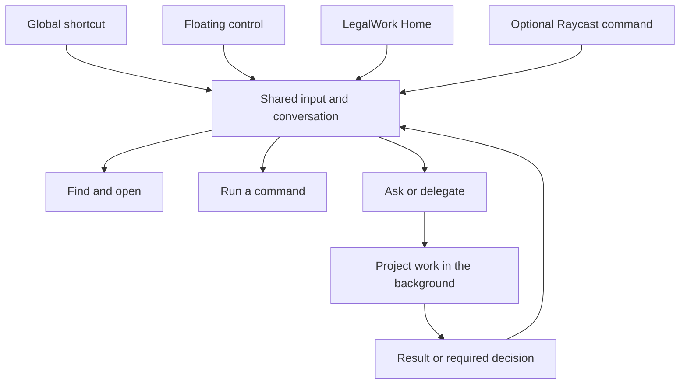

# Global Assistant: one entry point for LegalWork

Status: proposal for discussion; no runtime implementation in this change.

Build on the personal Assistant in [#232](https://github.com/eigenweltlabs/legalwork/pull/232), the dictation overlay from [#299](https://github.com/eigenweltlabs/legalwork/pull/299), and LegalWork's existing search and slash commands. The intended experience is one familiar input that is available from any application and inside LegalWork: find something, run a command, ask a short question, or delegate work to a project without choosing a project chat first.

This proposal is based on Assistant commit `aee752e8a34c147286fb1c2d4acee4488ff5eb4d`. The comparison with `dev` uses `bb77ce7ce2ef0a665ad3f0704a7994b32b54672d`; #299 is merged there. Source research was conducted on 21 October 2026. External applications were inspected through their repository documentation and selected source files, not installed or benchmarked.

## The experience

The user is writing in Word, reading a browser page, or working inside LegalWork. A configurable global shortcut or a click on the floating control opens a small input. It offers search results and commands immediately. A question expands the same surface into a compact conversation. A substantial task runs in the relevant project while the user stays where they are. Results and necessary questions return to that conversation.

Inside LegalWork, Home without a selected project opens the same Assistant with more room for history and results. The quick panel and Home share conversation identity, drafts, pending decisions and delegated work. Expanding the panel does not copy messages or start a second run.

The existing first-run setup remains a separate concern: “Home” here means the normal entry after onboarding, not removal of provider or permission setup.



### One input, explicit actions

| Input or action | Proposed behavior |
| --- | --- |
| A matter name, document title or phrase | Show ranked results from existing search sources, with project and result type visible. |
| `/` | Show available commands and skills, including argument and project requirements. Reuse the existing command catalog rather than creating a competing set of prompt templates. |
| A question or request | Offer an explicit “Ask Assistant” action. In conversation mode, Enter sends a message. |
| A project selector | Set the intended scope visibly. Global Assistant is the default outside the app; a last-used project must not silently become the target. |
| Add selection, file, window or screen region | Stage visible, removable context attachments before submission. |
| Expand into LegalWork | Open the same conversation, with the same outstanding work and attachments. |
| Copy or insert result | Perform an explicit output action; return to the originating app when appropriate. |

The selected result and footer must explain what Enter will do: open a result, execute a command, or send a request. Search and deterministic actions do not need an LLM round trip. Switching into conversation mode preserves the typed text. Exact shortcuts should be chosen alongside existing bindings; in today's search dialog, Tab already cycles result categories, so Raycast's Tab-to-AI behavior cannot simply be copied everywhere.

### A concrete task

1. In Word, select a clause and invoke LegalWork.
2. Choose “Add selection”; the panel shows the source app and attached text.
3. Ask: “Review this for our client in the Müller matter.”
4. The Assistant resolves the matter and asks only if essential scope remains ambiguous.
5. It creates or continues the appropriate project work and acknowledges briefly.
6. The panel can be dismissed while work continues. Reopening restores progress and any pending question.
7. The result returns as a short explanation and an actionable document or project-chat card. Detailed work can be opened in LegalWork.

## Existing LegalWork foundations

| Foundation | Observed implementation | Reuse and remaining work |
| --- | --- | --- |
| Personal Assistant | A server-owned Assistant workspace with one session per device-local day, project lookup, delegation, follow-up, stopping/redirecting sessions, and results returning to the Assistant. | Use the same identity and server operations from the quick panel. Do not create a second coordinator or a separate history store. |
| Compact conversation | The Assistant instructions normally request one to three short sentences. The UI suppresses routine tool activity and renders selected file, delegation and decision surfaces. | Reuse this presentation in a constrained window; keep pending approvals and questions accessible. |
| Home | On the inspected `dev`, sending without a selected project creates a project. #232 instead resolves the current Assistant session. | Build on the #232 routing. Unify input behavior and preserve the Home/quick-panel conversation. |
| Global dictation | Non-activating HUD, configurable global shortcuts, focused-display tracking, docking, paste-target preservation, cancellation, and background lifecycle handling. | Reuse desktop services and positioning behavior; add an independent launcher preference and a focusable panel. |
| Cross-project search | `CommandPalette` searches projects, chats, tasks and file contents; `useShellShortcuts` binds it within the renderer. | Expose its data and result actions in the global panel. The existing `window` key listener is not an OS-wide shortcut. |
| Slash commands | The chat composer loads and filters command options and parses invocations. | Make those commands available through the shared entry point, subject to their existing workspace requirements. |
| Recorder integration | #232 already exposes recorder status/control and library access to the Assistant. | Reconcile with #299 and subsequent recorder changes. The old Assistant control path still depends on the main renderer and checks for an installed transcription model. |
| Screenshot capabilities | Browser/computer-use capabilities exist, but the inspected entry points do not provide the proposed global screen-region/window attachment flow. | Add deliberate context capture and attachment staging as a separate slice. |

Source entry points:

- [Assistant role and tools](https://github.com/eigenweltlabs/legalwork/blob/aee752e8a34c147286fb1c2d4acee4488ff5eb4d/apps/server/src/opencode-plugins/legalwork-assistant-tools.ts), [daily session ownership](https://github.com/eigenweltlabs/legalwork/blob/aee752e8a34c147286fb1c2d4acee4488ff5eb4d/apps/server/src/main-assistant.ts), [Assistant navigation](https://github.com/eigenweltlabs/legalwork/blob/aee752e8a34c147286fb1c2d4acee4488ff5eb4d/apps/app/src/react-app/shell/assistant-navigation.ts).
- [Home submission routing](https://github.com/eigenweltlabs/legalwork/blob/aee752e8a34c147286fb1c2d4acee4488ff5eb4d/apps/app/src/react-app/shell/session-route.tsx), [compact chat presentation](https://github.com/eigenweltlabs/legalwork/blob/aee752e8a34c147286fb1c2d4acee4488ff5eb4d/apps/app/src/components/chat/assistant-chat-presentation.ts).
- [Dictation HUD](https://github.com/eigenweltlabs/legalwork/blob/bb77ce7ce2ef0a665ad3f0704a7994b32b54672d/apps/desktop/electron/audio/dictation-hud.mjs), [desktop lifecycle](https://github.com/eigenweltlabs/legalwork/blob/bb77ce7ce2ef0a665ad3f0704a7994b32b54672d/apps/desktop/electron/main.mjs), [search palette](https://github.com/eigenweltlabs/legalwork/blob/bb77ce7ce2ef0a665ad3f0704a7994b32b54672d/apps/app/src/react-app/shell/command-palette.tsx), [renderer shortcuts](https://github.com/eigenweltlabs/legalwork/blob/bb77ce7ce2ef0a665ad3f0704a7994b32b54672d/apps/app/src/react-app/shell/use-shell-shortcuts.ts), [composer](https://github.com/eigenweltlabs/legalwork/blob/bb77ce7ce2ef0a665ad3f0704a7994b32b54672d/apps/app/src/react-app/domains/session/surface/composer/composer.tsx).
- [Assistant recorder control](https://github.com/eigenweltlabs/legalwork/blob/aee752e8a34c147286fb1c2d4acee4488ff5eb4d/apps/app/src/react-app/domains/recorder/assistant-recorder-control.ts), [desktop recorder bridge](https://github.com/eigenweltlabs/legalwork/blob/aee752e8a34c147286fb1c2d4acee4488ff5eb4d/apps/desktop/electron/audio/assistant-recorder.mjs).

## GitHub research: useful patterns, not a replacement platform

### Cherry Studio: closest Electron implementation reference

[CherryHQ/cherry-studio](https://github.com/CherryHQ/cherry-studio) has a Quick Assistant alongside its main workspace. Its Electron service handles pinning, focus restoration, hiding, display placement and the relationship to the main window. Its React quick-window entry includes dictation support and a smaller set of runtime providers.

Use it to study ownership of a separate lightweight window and the failure cases around focus. In particular, the service documents macOS panel blur behavior and distinguishes window infrastructure from feature behavior. These are relevant test cases, not evidence that a workaround is needed unchanged in LegalWork's Electron version. LegalWork should implement the behavior using its own desktop services.

Sources: [QuickAssistantService](https://github.com/CherryHQ/cherry-studio/blob/41c240712e28ff03d17115e522a5394e605fe374/src/main/services/QuickAssistantService.ts), [React window entry](https://github.com/CherryHQ/cherry-studio/blob/41c240712e28ff03d17115e522a5394e605fe374/src/renderer/windows/quickAssistant/QuickAssistantApp.tsx). The repository identifies its Community Edition as AGPL-3.0 in its [README](https://github.com/CherryHQ/cherry-studio/blob/41c240712e28ff03d17115e522a5394e605fe374/README.md).

### Tinycast: strongest reference for conversation continuity

[abue-ammar/tinycast](https://github.com/abue-ammar/tinycast) documents a Quick AI view inside the palette and a larger AI Chat window sharing one history. It also documents selection-based Quick Actions, available both as launcher commands and shortcuts, with a common execution path that captures the original target before hiding the palette.

Adopt the continuity rule and common action dispatch. Its SwiftUI/AppKit implementation is a behavioral reference rather than a component that can be dropped into LegalWork. Its current README lists macOS 26+ and AGPL-3.0.

Sources: [shared chat history](https://github.com/abue-ammar/tinycast/blob/4f3dd64a7c2f667c500fabc8a06adfee780147a6/docs/features/ai.md), [Quick Actions](https://github.com/abue-ammar/tinycast/blob/4f3dd64a7c2f667c500fabc8a06adfee780147a6/docs/features/quick-actions.md), [README](https://github.com/abue-ammar/tinycast/blob/4f3dd64a7c2f667c500fabc8a06adfee780147a6/README.md).

### Asyar: closest search-to-agent product flow

[Xoshbin/asyar](https://github.com/Xoshbin/asyar) combines a launcher, explicit AI mode, saved threads, configurable agents and MCP tools. Its documented quick flow changes the search bar into an AI input and continues the conversation there. Commands can also use selection, clipboard or typed arguments and return output through paste, copy or a HUD.

Adopt explicit input/output choices and discoverable command shortcuts. Keep LegalWork's existing coordinator and project permissions. Automatic selection replacement is not the proposed default for legal work: start with a preview and explicit insert action. Asyar uses Tauri/Rust and Svelte; its root license is GPL-3.0, while some SDK components have separate licenses. This proposal introduces no dependency on it and makes no performance claims based on its self-published benchmarks.

Sources: [AI and agents](https://github.com/Xoshbin/asyar/blob/bb3527a09648f3288cef8d43ee8843851d1b33be/docs/guide/features/ai-and-agents.md), [silent-command input/output model](https://github.com/Xoshbin/asyar/blob/bb3527a09648f3288cef8d43ee8843851d1b33be/docs/reference/silent-agents.md), [root license](https://github.com/Xoshbin/asyar/blob/bb3527a09648f3288cef8d43ee8843851d1b33be/LICENSE).

### Vicinae: commands and extension boundaries

[vicinaehq/vicinae](https://github.com/vicinaehq/vicinae) is a native command palette with search, clipboard, window actions, scripts and React/TypeScript extensions compatible with the Raycast ecosystem. It is useful for studying a consistent result/action vocabulary and separate entry points into the same action. Its repository is GPL-3.0.

LegalWork already has skills, commands, connectors and an execution engine. A new general-purpose extension host is unnecessary for this proposal. Vicinae is a launcher reference, not evidence of the project orchestration required here.

Sources: [README](https://github.com/vicinaehq/vicinae/blob/3a854e136b8fa91da8ea0eff2164ef2e03f39ea6/README.md), [license](https://github.com/vicinaehq/vicinae/blob/3a854e136b8fa91da8ea0eff2164ef2e03f39ea6/LICENSE).

### Raycast extensions: optional integration surface

[raycast/extensions](https://github.com/raycast/extensions) contains store extensions and React extension examples. It is the useful public code surface for a small LegalWork integration; it is not the source of the Raycast desktop application. The repository carries an MIT license.

Start with “Open LegalWork Assistant”, “Ask LegalWork with selection” and “Search LegalWork projects”. Each command should call the same LegalWork entry operations as the native shortcut. Raycast's [system utilities](https://developers.raycast.com/api-reference/utilities) provide application and URL integration; [deeplinks](https://developers.raycast.com/information/lifecycle/deeplinks) address installed Raycast commands. LegalWork already registers its own URL scheme, but an Assistant launch route still needs to be defined and implemented.

Sources: [extension repository](https://github.com/raycast/extensions/blob/ec883a97c47444fadfaa5e467f5782fa2cb89aa2/README.md), [license](https://github.com/raycast/extensions/blob/ec883a97c47444fadfaa5e467f5782fa2cb89aa2/LICENSE), [existing LegalWork deep-link parsing](https://github.com/eigenweltlabs/legalwork/blob/bb77ce7ce2ef0a665ad3f0704a7994b32b54672d/apps/app/src/app/lib/legalwork-links.ts).

### Gauntlet: historical design reference

[project-gauntlet/gauntlet](https://github.com/project-gauntlet/gauntlet) describes TypeScript/React plugins, one-shot commands, inline results under the search bar, aliases and global shortcuts. These distinctions are useful for designing a shared command model. Its [README explicitly says development has stopped](https://github.com/project-gauntlet/gauntlet/blob/ca066da5c9d56bd53a739c0dda1572fccc5019a8/README.md), so it is not proposed as a dependency or product foundation.

### Research conclusion

Build a LegalWork quick panel on existing LegalWork services. Use Cherry Studio for Electron lifecycle questions, Tinycast for shared-history behavior, Asyar for the search/agent transition, and Raycast's extension API for an optional adapter. The repositories provide reference patterns; no third-party code or artwork is included in this proposal. Component-level licensing and maintenance would need separate evaluation before any later code reuse.

## Proposed architecture

### Desktop host and focus

Retain a non-activating idle/dictation HUD and add a focusable quick panel. The current HUD uses `focusable: false` to preserve the paste target; making that same window take keyboard focus indiscriminately would change dictation behavior. The two windows can look like one expanding control and share placement and theme services.

The desktop host owns global shortcut registration, previous foreground target, panel visibility, display placement, capture permissions and lifecycle. The renderer consumes existing server APIs for conversations, commands and project work. A small renderer entry should avoid mounting the complete workspace shell merely to accept a prompt.

Capture the originating app/window identity before focusing the panel. Resolve requested selection or screenshot context against that origin, not against the newly opened LegalWork window. Dismissal restores focus where possible. Blur and Escape preserve the draft; dismissing the panel does not cancel background work. Stop is an explicit action.

“Available anywhere” means the desktop app is resident in the background, even with its main window hidden and dictation disabled. An explicit Quit still exits. Raycast or a launch URL may start the app when it is not running. The launcher needs its own background-presence setting rather than relying on dictation being enabled.

### Shared conversation and action ownership

Use the Assistant workspace/session and existing server events as the source of truth. Home, quick panel and an optional adapter submit through common operations. They must share draft ownership and submission identity so a surface switch cannot resend the same message or create duplicate project work. Errors retain the draft and expose the actual send state.

For the first version, reopening resumes the current daily Assistant session from #232. Do not create a new chat on every summon. Handle day rollover through the existing daily-session resolver, while keeping outstanding work and decisions discoverable. Independent quick threads are a later choice that would require an explicit history model.

Reuse deterministic actions for navigation, search and recording controls; use the Assistant for natural-language interpretation and coordination. A shared action catalog should describe identity, label, aliases, required arguments, scope, required capabilities and execution target. Existing slash commands and skills should feed that catalog, not be reimplemented as unrelated launcher commands. Server authorization remains authoritative.

The Assistant's broader visibility does not change what a project chat may access. Remote or unavailable sources should be labelled; an empty search result must not imply that every connected system was searched. Project selection, task input and context attachments remain distinct so a window title cannot silently authorize a different matter.

### Voice and context

Expose three clear voice actions using the existing capture/transcription services:

- **Dictate into this app:** preserve the external destination and insert the transcript.
- **Speak to Assistant:** place transcription in the Assistant draft; keep Stop and Send distinct.
- **Record a meeting:** start the existing recorder flow with an explicit global/project destination.

The panel displays which action is active and respects the current microphone/recording ownership. Opening search must not steal an ongoing recording or reinterpret the existing hold/double-tap dictation shortcut.

Selection, clipboard and screenshot access are user-invoked inputs. Show the captured source and removable preview before send, handle unavailable permissions locally, and avoid capturing the overlay itself. Screen text and images are task material, not instructions. Add per-turn context through the existing message/reminder mechanism; keep the system prompt stable.

### Optional Raycast adapter

Keep LegalWork fully usable without Raycast. The adapter should focus or prefill the native panel and optionally show direct search results. It should not create another Assistant backend or independent message history. A future launch URL can express opening the panel; any context-bearing local transport must be authenticated and must not place server tokens or confidential document contents in URL query parameters. External invocation cannot bypass the permissions or decisions enforced by LegalWork.

## Delivery sequence

1. **Reconcile the foundations.** Bring #232 forward onto current `dev`, retaining #299 and recorder fixes. The analysis against the pinned commits found 16 conflicted files, including recorder state, chat surfaces and Electron main. This is a snapshot, not a conflict count guaranteed for future heads. Resolve the Assistant recorder/model-control overlap before adding another entry point. This proposal branch itself contains only documentation and targets the Assistant branch.
2. **Prove one complete path.** Global shortcut or HUD action opens a compact Assistant, a request delegates to a project, a result/question returns, and opening Home continues the same conversation. Reuse current session and permission handling. Cloud/mobile execution is not a prerequisite for this desktop slice.
3. **Unify search and commands.** Add existing cross-project results, action selection, slash commands and visible scope to the shared input. Preserve deterministic execution and document keyboard behavior.
4. **Add context capture and voice targets.** Attach selected text, files, a window or a screen region. Distinguish external dictation, Assistant dictation and meeting recording. Preview and explicit insert come before optional one-shot transformations.
5. **Add the Raycast adapter.** A small integration uses the same entry contract. Verify it does not duplicate conversations, sends or approvals.

A full OS launcher, a Raycast-compatible extension runtime, a new AI backend, independent quick-chat histories and continuous screen monitoring are outside the first implementation. The first release can use the existing local Assistant execution path; cloud sync and mobile rollout remain the work of #232 and its backend counterpart.

## Acceptance scenarios for implementation

| Scenario | Expected result |
| --- | --- |
| Invoke from Word/browser with LegalWork hidden | Panel appears on the intended display without opening or navigating the main workspace. |
| Invoke with dictation disabled | Assistant remains available through its own configured shortcut/background setting. |
| Type a project name, select a result, or choose a slash command | The action and scope are visible; deterministic actions do not call the model. |
| Send once, expand into Home, then reopen the panel | One message and one run; same conversation, attachments and pending decisions. |
| Dismiss during delegated work | Work continues; reopening shows its actual state and returned result. |
| A delegated chat requests approval or information | Exact request remains actionable from the shared surface; no inferred approval. |
| Add selection or capture a window | Context comes from the original app, is previewed, and can be removed before send. |
| Switch voice actions or invoke during recording | Ownership is preserved; no accidental paste, submission or second capture. |
| Permission denied or source inaccessible | Recoverable explanation; typed draft and ongoing work remain intact. |
| Sleep/wake, fullscreen, display change, shortcut collision | Existing shortcuts and focus restoration remain reliable or expose a clear recovery action. |
| Day rollover or backend restart | Daily-session resolution and reconnect preserve discoverable work without duplicate submission. |
| Trigger through Raycast | Same behavior and authorization as the native entry; LegalWork also works without Raycast installed. |

Measure warm invocation latency, time to first usable result and idle resource use before setting performance budgets. Test focus, selection and screen capture on real macOS and Windows hosts; mocked tests alone do not prove native behavior.

## Decisions for maintainer discussion

- Initial global shortcut and conflict behavior, including coexistence with dictation and other launchers.
- Whether the floating control is always visible or optional while the shortcut stays available.
- Placement: expand near the docked control or use a central launcher position on the active display.
- Which actions appear in the empty state and how users switch between search and conversation.
- When the Raycast adapter becomes worth shipping after the native path works.

The recommended defaults are an optional floating control, configurable shortcut, current daily Assistant session, explicit context attachment, and compact replies with project delegation for substantive work.

## Validation of this proposal

This document changes no application behavior. Research findings distinguish repository-documented features, inspected code, and proposed LegalWork behavior. External sources are linked to inspected revisions where available.

The existing Assistant baseline was checked using unchanged files extracted from `aee752e8a34c147286fb1c2d4acee4488ff5eb4d`:

```sh
node --test apps/desktop/electron/assistant-recorder.test.mjs apps/desktop/electron/system-dictation.test.mjs apps/desktop/electron/power-lifecycle.test.mjs
```

Result: 13 passed, 0 failed. These tests cover the existing recorder bridge, dictation and power lifecycle; they do not validate the proposed panel, the complete #299 integration, or native multi-window behavior. No UI video/screenshot is attached because this is a documentation-only proposal. The acceptance scenarios above define the flows to demonstrate in implementation PRs.
